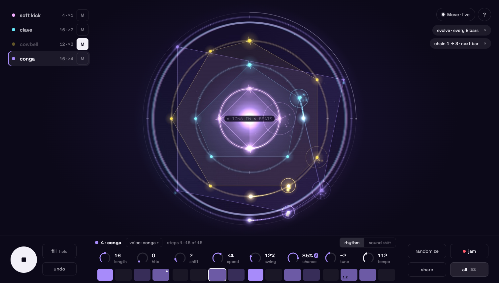

# One surface, one row, one sheet



## The concept in one sentence

**The rings are the screen, one row of controls under them is the Move's own face (8 knobs, 16 steps), and everything
else lives in one searchable sheet, which shows itself only as one button ("all ⌘K") and as a pill for every mode
that is switched on.**

## Where I stand

Today's screen is a control panel with a picture in the middle: 160 controls, 13 drawers, two scrolling columns, a
quest card, three lines of status and four kinds of help text, all at the same visual weight. The panel built a deep
instrument, and every feature got its own place on the face. That was right while we were building it. It is wrong for
playing it.

My rules for this proposal:

1. **One hierarchy, three levels.** The rings first (look, touch). The console second (the hand). The sheet third (the
   head). Nothing sits between the levels.
2. **The screen mirrors the Move, not the other way round.** The Move mapping does not change. The console shows the
   same 8 knobs in the same order, the same Shift page, the same held-step page, and the same 16 step buttons. Learn
   one, know both.
3. **No hidden mode without a signifier.** Anything that changes what the instrument does (evolve, dice locked, record
   armed, a chain, a queued slot, fill latched, a jam take, solo, a pending mute, MIDI clock follow) shows as a pill
   while it is on. Off = gone. A pill is a button to its settings, and its × turns it off.
4. **Colour means lane.** The four to six lane colours are the only hues on the screen. White means on or selected. Red
   means recording. Everything else is grey. No glow, shadow or gradient on the controls; the canvas has all of those.
5. **One typeface.** Space Grotesk, tabular numbers, three sizes (16 values, 14 controls, 12 labels). Major Mono Display
   leaves the functional text (status line, legend, the "aligns in" countdown); it was decoration doing a label's job.
6. **Accessibility is the same interface, not a second one.** Every console control is a real button or slider; the
   sheet is a real tabbed region; the search makes every one of the 189 controls reachable by name.

## Who it is for

- **The conductor at 1512×860 with a Move on the desk.** They play with the hands on the Move and glance at the
  screen. The screen has to say what the hands are doing (which lane, which knob page, which step held, which mode is
  on) and get out of the way. Today it says it in four places at once.
- **The experimental musician without a Move.** Mouse and keyboard. The rings plus the console are a full instrument:
  every Move knob and step is on screen, and the rings take hits, rotation, length and locks by hand (I1).
- **The screen-reader and keyboard player.** Play is the first Tab stop. The console is about 45 stops, in the order
  of the Move. Anything else is ⌘K and its name.
- **Not for**: the first-time visitor who wants a menu of everything on the face. They get the demo playing, one quest
  pill, and a bright "all" button. I accept that they meet fewer features at first glance; that is the point.

## The screen at 1512×860

Real mock: `mock.html` → `mock-1512x860.png` (main) and `mock.html#sheet` → `mock-sheet-1512x860.png` (the sheet
open on "pattern"). The rings in the mock are a capture of the real canvas (afro groove, playing, lane 4 selected).

```
 0 ┌──────────────────────────────────────────────────────────────────────────────────────────────────────┐
   │ ● soft kick   4·×1  [M]                                                    (● Move · live)  ( ? )     │
   │ ● clave      16·×2  [M]                   . ˚  ─ ─ ─ ─  ˚ .                (evolve · 8 bars ×)       │
   │ ● cowbell    12·×3  [M]▮              ˚                         ˚          (chain 1→3 · next bar ×)  │
   │▌● conga      16·×4  [M]            ˚        ○ ─ ─ ─ ─ ○           ˚                                  │
   │  lanes = legend =                 │      ○     ◉ core   ○          │       modes that are ON,        │
   │  selector = mutes                 │      ○  aligns in 6 beats ○     │       nothing when idle         │
   │                                    ˚        ○ ─ ─ ─ ─ ○           ˚                                  │
   │                                       ˚                         ˚                                     │
   │                                           ˚ .  ─ ─ ─ ─  . ˚     the rings: 700 px (today ~600)       │
716├──────────────────────────────────────────────────────────────────────────────────────────────────────┤
   │  ╭────╮ [fill hold]  ● 4 · conga  [voice: conga ▾]  steps 1–16 of 16        [rhythm|sound⇧] [randomize][● jam] │
   │  │ ▶■ │              ◔16  ◔0   ◔2    ◔×4   ◔12%  ◔85%A ◔−2   ◔112                   [share   ][all ⌘K]│
   │  ╰────╯ [undo     ]  length hits shift speed swing chance tune tempo                                  │
   │                      [▮][ ][▯][▮•][ ][ ][▣][▯] [▮][ ][▮][▯][ ][▮1:2][▮][ ]                             │
860└──────────────────────────────────────────────────────────────────────────────────────────────────────┘
      transport (3)        the selected lane = the Move's face (1 select, 2 page, 8 knobs, 16 steps)    actions (4)
```

- **Rings**: full bleed, centred on the stage above the console, 700 px square (the outer ring and its cycle arc
  about 650 px across; today about 600 between the two columns). Nothing overlaps them.
- **Top left, the lanes**: the legend (C5), the lane tabs (T4) and the mutes, in one list, inner ring first, as many
  rows as lanes (4 or 6). Each row is a 44 px tab (colour, name, length · speed) and a 36 px **M**. Selected = white
  text and a bar in the lane colour. Muted = dimmed name, white M.
- **Top right**: the Move (one pill: "Move · connect", "Move · live", "Move · edit"), help **?**, and under them the
  **mode pills**.
- **The console** (144 px, one hairline above it, no boxes):
  - transport: **play / stop** (80 px circle, the only filled white control), **fill** (hold), **undo**.
  - the selected lane, on a 16-column grid where each knob sits over two steps: the lane name in its colour, the
    **voice** select, the page switch **rhythm | sound** (sound = Shift, as on the Move), **8 knobs**, **16 steps**
    (a "17–32" page switch appears only on lanes longer than 16).
  - actions: **randomize** (long-press = wild), **jam**, **share** (one tap = the link), **all ⌘K**.

### Controls on the main screen

| | today (first load, 1512×860) | proposal (idle) | proposal (two modes on) |
|---|---|---|---|
| visible interactive controls | **160** | **44** + the canvas | 46 + the canvas |
| of which are the Move's knobs and steps | 9 knobs + 16 steps, plus 8 sound knobs elsewhere | 8 knobs + 16 steps | same |
| drawers / disclosure widgets | 13 | 0 (one sheet) | 0 |
| always-on status text | 3-line readout + legend + quest card + help paragraphs | 0 lines | 2 pills |
| page scroll / column scroll | right column scrolls | none | none |

The 44: lanes 4 tabs + 4 mutes, Move, help, play, fill, undo, voice, 2 page buttons, 8 knobs, 16 steps, randomize, jam,
share, all. 24 of them are the instrument itself (knobs and steps); the chrome is 20.

## The interaction model

### Three levels

| level | what | how you get there | leaves by |
|---|---|---|---|
| 1 · rings | look; hits, rotation, length, locks by hand (I1, unchanged) | always there | — |
| 2 · console | the Move's face for the selected lane + transport | always there | F (focus mode) hides it |
| 3 · sheet | everything else, in six tabs, searchable | **all ⌘K**, ⌘K, `/`, a mode pill, the "A" on a knob, "more…" on the step page | Esc, all ⌘K again, click on the rings |

The sheet is a 456 px panel on the right of the stage (`mock-sheet-1512x860.png`). The rings slide left and shrink a
little; the console stays, so you keep playing while you change a setting. The sheet has **one search field** on top
(every control by its name and its synonyms: "euclid" finds hits, "rotation" finds shift, "stems" finds the export)
and six tabs: **lane · pattern · groove · perform · export · setup**. A search result focuses the control in its tab;
an action result ("groove: house", "export stems", "init") runs on Enter.

### The knob row has three pages, exactly the Move's

| page | the Move | the screen | the 8 knobs |
|---|---|---|---|
| **rhythm** (default) | knobs | page "rhythm" | length · hits · shift · speed · swing · chance · tune · **tempo** (white: all lanes) |
| **sound** | Shift + knobs | page "sound", or the Move's Shift held | decay · tone · drive · snap · color · send · pan · level |
| **step N** | hold a step + knobs | long-press / right-click / Alt+click a step cell **or a planet** | tune · chance · velocity · decay · tone · snap · color · condition |

- On the step page the console header says **"step 7 · conga"** in the lane colour, with **clear**, **more…** (nudge,
  repeats, stroke, slice, start/end, direction, fade, spacing, pitch ramp: the sheet's lane tab, scrolled to that step)
  and **done** (Esc). The 16 step buttons keep showing the steps; the held one is outlined.
- This **replaces three lock editors with one**: today's lock panel in the lane drawer, the radial menu on a planet (I1)
  and the Move's hold-step page become the same row.
- When the Move's Shift is held or a Move step is held, the screen follows: the page switches while the hand is there
  and comes back when it lets go. The screen shows what the hand is doing.
- Automated parameters keep their **A** mark (A4). Clicking the A opens the curve strip for that parameter in the
  lane tab.

### Click, drag, key, Move

| input | does |
|---|---|
| click a lane row / a ring | select that lane (the console follows) |
| click **M** | mute; Shift+click or long-press = solo (also in the lane tab, so solo is never gesture-only) |
| click / tap a step | off → on → accent → off (T1, unchanged) |
| long-press / right-click / Alt+click a step or planet | the step page on the knob row |
| drag a knob | as today (gauge.js: drag, wheel, arrows, double-click = reset) |
| on the rings | I1 unchanged: tap a tick = hit, tap a planet = cycle, drag along = rotate, drag across / pinch = length, drop an audio file = sample |
| Space · F · ? | play / stop · focus mode · help (unchanged) |
| **⌘K** or **/** | the sheet with the cursor in the search |
| ⌘S / ⌘O | save to the library / open it (the pattern tab) |
| ⌘Z / ⇧⌘Z | undo / redo |
| Alt+1–6, the pad rows, hold 0 | unchanged |
| Esc | in one order: dialog → step page → sheet → focus mode → give the keys back (the "One Escape handler" backlog item) |
| the Move | **unchanged**, every row of the "Move controls" table |

### Modes as pills

A pill appears when its mode turns on and disappears when it turns off. It is a button (opens the mode's settings in
the sheet), with a × (turns it off). Pills, in a fixed order: **record armed** (red, with "knobs: touch / latch" when
set) · **jam** (red, beats counted; after a take: "download · discard") · **fill next bar** · **chain a → b** · **slot
N at next bar** · **evolve** · **dice locked · seed** · **solo** · **mute at next bar** · **following MIDI clock** ·
**quest n of 5** (first visits) · **your beat is here · start fresh** (returning visits, F3). The pills live in a
`role="status"` region: a screen reader hears "evolve on", "chain stopped", once.

## Where every current feature goes

"Sheet → x" = the sheet's tab x. "⌘K" = also by name in the search (true of every control; I list it where it is the
main route). "Move" = unchanged Move gesture.

### Transport and header

| feature | today | in the proposal |
|---|---|---|
| play / stop | top strip, big button | console, 80 px circle, first Tab stop; Space; Move Play |
| tempo + tap (C1) | top strip knob + "tap" | knob 8 on the rhythm page (white, "all lanes"); tap: Sheet → perform, Move Shift+Record |
| undo / redo | top strip | undo in the console; redo ⇧⌘Z, Move Shift+Undo, Sheet → perform |
| fill (hold) | top strip | console "fill (hold)"; hold 0; Move hold Layout |
| fill next bar (P3) | top strip | Sheet → perform; Move Shift+Layout; pill while waiting |
| performance filter (P6) | top strip knob | Sheet → perform; Move wheel |
| delay throw (P6) | top strip "throw (hold)" | Sheet → perform (hold); Move hold + |
| jam | top strip | console "jam"; pill while recording; download / discard on the pill after the take |
| share link (I2) | top strip "share" | console "share" (one tap, unchanged) |
| share 4 bars audio (I3), postcard (I5) | "…" menu | Sheet → export, "share" block; the toast after "share" says "other ways…" |
| help (C3) | "?" | "?" top right; the dialog gains a second tab "Move" (today's Move popup) |
| home link "MIDI Warz" | header | Sheet → setup, first line (no logo on the instrument's face) |
| Move connect / disconnect (T6) | status pill + "Connect Move" | one pill: "Move · connect" → "Move · live / edit"; click = connect, or a small popover (live mode, disconnect, the Move controls) when connected; hidden without Web MIDI |
| live mode toggle (P1) | chip next to Connect | inside the Move pill's popover; the pill's word says the mode |
| status readout (C2) | three-part line under the header | **gone**: tempo on knob 8, state on the play button, modes as pills, kit in the lane tab |
| announcements, toast | sr-only region, toast | unchanged (toast centred above the console) |

### The canvas

| feature | today | in the proposal |
|---|---|---|
| rings, comets, planets, bloom, cycle arc, ghost flashes, condition arcs, planet opacity (V6) | centre, between the columns | the whole stage, ~15 % larger; countdown in Space Grotesk |
| aligns in N bars (F5) | on the core | unchanged; also in the canvas's accessible name, updated per bar (not live) |
| I1 gestures (tick, planet, rotate, pull, pinch, drop a sample) | on the rings | unchanged |
| long-press planet → radial lock menu | radial menu | the step page on the knob row (one lock editor) |
| legend (C5) | row of labels over the rings | the lane list, top left (it is also the selector and the mutes) |
| focus mode (C5) | F, Settings button, "exit focus" | F; hides lanes, pills, console; "exit focus" on touch; listed in help and ⌘K |
| gift card for a shared link (I2) | dialog | unchanged |

### The selected lane (today's right column)

| feature | today | in the proposal |
|---|---|---|
| lane tabs (T4), lanes 5–6 | chips over the lane drawer | lane list rows, top left; Alt+1–6; Move Track |
| length, hits (euclid), shift (rotation), speed (ratio) (R2) | lane drawer knobs | knobs 1–4, rhythm page |
| swing, chance, tune | lane drawer knobs | knobs 5–7, rhythm page |
| push / pull (G2), velocity humanize (G3) | lane drawer knobs | Sheet → groove ("this lane") |
| swing template (G6) | lane drawer segmented | Sheet → groove ("this lane"), next to the swing amount |
| steps (T2, T5, L1, G4) | 32 cells, two rows, 12 "outside the loop" | 16 cells under the knobs; "17–32" switch only past 16; cells outside the loop are not rendered; the strip says "steps 1–16 of 16" |
| step locks, conditions, repeats, stroke, slice, nudge, trim, direction, fade, spacing, ramp (S1, S3, L3, G1, R4, V4) | lock panel in the lane drawer | step page on the knob row (tune · chance · velocity · decay · tone · snap · color · condition); the rest: "more…" → Sheet → lane, step block |
| automation strip, parameter picker, ½, ×2, clear, clear lane (A4) | under the steps | Sheet → lane, "automation"; the A on a knob opens it |
| voice | select in "sound" | console select, next to the lane name |
| kit (all lanes) | select in "sound" | Sheet → lane (top); Move Shift+◀▶; ⌘K "kit" |
| decay · tone · drive · snap · color · send · pan · level | "sound" knobs | the sound page (Shift) |
| mute (P2), mute on next bar | lane drawer button + option | M on the lane row; "on next bar" in Sheet → perform; a pending mute is a pill |
| solo | lane drawer button | Shift+click / long-press M; Sheet → lane; Move Shift+Mute; pill while any lane is soloed |
| chokes | lane drawer select | Sheet → lane |
| sample: load file, mic, break file + slices 8/16, Unassembler slices, sample name, trim, reverse (S1–S3) | lane drawer | Sheet → lane, "sample"; drop a file on a ring (unchanged) |
| generative: euclid mask AND/XOR (V3), modulate (V5), timbre dice, scale | lane drawer (everything mode) | Sheet → lane, "generative" |
| clear lane | right column button | Sheet → pattern; Move Delete (live: hold) |

### Pattern level (today's right column top + left drawers)

| feature | today | in the proposal |
|---|---|---|
| init | button | Sheet → pattern "start from"; ⌘K |
| save / load | buttons | Sheet → pattern "library"; ⌘S / ⌘O |
| randomize (F4) / wild | two buttons | console "randomize"; long-press / Shift / right-click = wild; a "wild" chip in Sheet → pattern (a visible route); Move Capture |
| starter grooves (F1), seed of the day (I5) | chip rows on the main screen | Sheet → pattern "start from"; ⌘K "groove: house" |
| first-visit demo (F2), welcome back (F3) | demo + welcome bar | demo unchanged; welcome = a pill "your beat is here · start fresh ×" |
| library + gallery thumbnails (I4) | Library drawer | Sheet → pattern "library" (thumbnails kept) |
| slots 1–16, slot menu (save, chain, erase) (T1) | Patterns drawer | Sheet → pattern "slots"; Move Loop / Duplicate + steps |
| chain, stop chain, bars per slot | Patterns drawer | Sheet → pattern; pill "chain a → b" while running |
| switch at once / next bar / cycle, restart on change (P4) | Patterns drawer | Sheet → pattern; pill "slot N at next bar" while queued |
| meter (R3), 4 / 6 lanes (L2) | Patterns drawer | Sheet → pattern "shape" |

### Groove, generative, dice

| feature | today | in the proposal |
|---|---|---|
| global humanize | Humanize drawer | Sheet → groove; Move Shift+wheel |
| evolve on/off, home = now, touches, every / amount / home after / gravity / max cycle, weights, lanes (V1) | Evolve drawer | Sheet → groove "evolve"; pill while on; Move − and Shift+Capture |
| coupling mode, amounts, matrix (V2) | Evolve drawer | Sheet → groove "coupling" |
| dice free / locked, seed, re-roll, pattern from seed, repeat | Dice drawer (everything) | Sheet → groove "dice"; pill "dice locked · seed" while locked |

### Record and perform

| feature | today | in the proposal |
|---|---|---|
| arm record, quantize, accent above, pitch pads | Record drawer | Sheet → perform "record"; pill while armed; Move Record |
| knob recording off / touch / latch (A3) | Record drawer | Sheet → perform; shown on the record pill |
| tap tempo, reset phase | top strip, Settings | Sheet → perform |
| filter, throw, fill next bar, mute on next bar | top strip, lane drawer | Sheet → perform (and the Move, where they belong) |

### Export and MIDI

| feature | today | in the proposal |
|---|---|---|
| copy share link | Export drawer | console "share"; Sheet → export |
| length, render as loop, format (bits, rate), ring-out, dry stems, print FX, MIDI of, MIDI tracks (E1–E3, E6) | Export drawer | Sheet → export "settings" (one compact block) |
| WAV, stems, MIDI, kit (E4), export all (E5), new roll (B5), status | Export drawer | Sheet → export, one row of five, "export all" the primary one; status under them; ⌘K "export …" |
| MIDI ports, out, clock out, note / channel per lane, gate, out offset, auto offset (P5), stroke notes, clock in, follow, CC per parameter (A7) | MIDI drawer (everything) | Sheet → setup "MIDI"; pill "following MIDI clock" while following |

### Setup, learning, diagnostics

| feature | today | in the proposal |
|---|---|---|
| simple / everything switch (I7) | top of the left column | **gone**: one interface; plain words everywhere ("hits", "shift", "speed", "chance"); the technical word in the tooltip and in the search ("euclid", "rotation", "ratio", "probability") |
| quests (I6), skip, hide | card at top right | a pill "quest 1 of 5: make 3 against 4" (click = the hint, × = hide); Sheet → setup "learn" lists all quests and badges |
| advanced drawers unlocking with quests (I6) | `.adv` drawers | gone: the sheet always has everything (the I6 promise "never hidden from power users" holds) |
| engine synth / dsp | Settings drawer | Sheet → setup |
| nerd stats | drawer | Sheet → setup "diagnostics" |
| stress meter (C4) | `?debug` | unchanged (`?debug`), shown in Sheet → setup "diagnostics" |
| Move controls table | popup bottom left | the help dialog, tab "Move"; the Move pill's popover links to it |

Nothing in the model, the audio, the exports or the Move mapping changes. Every id in `BACKLOG.md` (B1–B12 are fixes
with no control; F, T, C, G, R, L, S, E, P, V, I, A as above) keeps working where it works today.

## What disappears from view

- The left column (10 drawers) and the right column (quest, 6 action buttons, 8 groove chips, lane chips, the lane
  drawer with 9 + 8 knobs, swing template, sample row, generative block, 32 step cells).
- The top strip except play, fill and undo (tempo moves to knob 8).
- The three-part readout, the "simple / everything" switch, the "Move" popup, help paragraphs, every hint line.
- The decorative font in functional text; glows and coloured fills on controls; cyan as a control colour.
- Twelve "outside the loop" step buttons.

## What it costs

| phase | work | size |
|---|---|---|
| 1 · stage and console | a CSS grid (stage / console / sheet), replacing `layoutHud()`'s measuring (backlog "A CSS grid stage"); the console's three groups; today's drawer DOM moved, ids kept, into six sheet tabs so `app.js` wiring keeps working | M |
| 2 · the knob row | one row of 8 gauges with three pages (rhythm / sound / step), following the Move's Shift and held step; the lock panel and the radial menu become the step page; "more…" block in the lane tab | L |
| 3 · lanes and pills | lane list (tab + mute, solo on Shift / long-press); mode pills replacing readout, welcome bar, quest card, jam panel; one Escape order | M |
| 4 · find | ⌘K index built from the DOM's accessible names + a synonyms table (plain ↔ technical words) + actions | M |
| 5 · type, colour, size | one font, three sizes, lane colours only, contrast ≥ 4.5:1 for every label (the mock's faintest grey is at the limit; lift it), targets ≥ 40 px desktop / 44 px touch | S |
| 6 · phone | lanes as a row of dots, rings square, console as play + 2×4 knobs + 2×8 steps (the Move's pad shape), sheet as a full-height bottom sheet; keep ORBIT2-03/14 touch rules | M |
| 7 · tests and audit | e2e tests that open drawers by id move to sheet tabs; Tab order, VoiceOver pass, reduced motion | M |

About three playbook phases of the size the lab is used to (L overall). Phase 1 alone already ships most of the calm.

## Risks

1. **The knob row means three things** (biggest). One place for lane, sound and step is the boldest call here and the
   most likely to confuse. Mitigations: the page name and the lane / step label in the header, the knob arcs change
   colour (lane colour → white for global → outlined for step), Shift and held step are quasimodes on the Move (they
   end when the hand lets go), and the screen's step page has an explicit "done".
2. **Discoverability.** Grooves, export and evolve go from one click to two (or a search). A newcomer who never opens
   "all" meets a smaller instrument. Mitigations: "all ⌘K" is the second-brightest control; the first quest pill
   points at it; every toast that mentions a feature names its tab.
3. **Mouse-only performers** lose throw, filter and fill latch from the top level. I think they belong to the Move
   and the keyboard; if the conductor disagrees, a fifth action button is cheaper than today's strip.
4. **Test churn.** Many e2e checks open drawers by id; phase 1 keeps the ids, but the sheet's tab must open first.
5. **Smaller windows.** At 1280×720 the lane list (6 lanes) and the pills come close to the rings; the stage must
   shrink the rings, not overlap them.

## What I would test first

1. **Five tasks, five people, today vs this** (2 with a Move, 3 without), at 1512×860: make 3 against 4 · load the
   house groove · lock the tune of step 5 · export stems · mute the hat on the next bar. Time, success, and whether
   they find "all ⌘K" without being told.
2. **The knob row's pages, with a Move.** Hold a step, turn a knob, look up: can they say which page the screen shows
   and which lane it edits? Three wrong answers in five and I split the step page out.
3. **A cold VoiceOver walk.** Play in one Tab; the steps of lane 2 in under ten; "stems" by search in under five
   keys; every pill announced once.

## Files

- `mock.html`: the static mock (1512×860; `#sheet` shows the sheet open on "pattern"); `rings.jpg` is a capture of the
  real canvas.
- `mock-1512x860.png`: the main screen. `mock-sheet-1512x860.png`: the sheet open.
