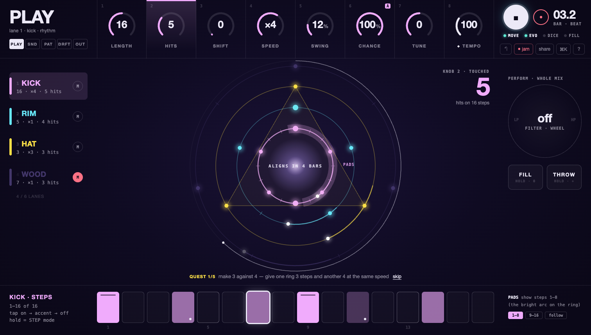

# Orbits: the Move's missing display



## 1. The concept in one sentence

**The screen becomes the big display the Ableton Move doesn't have: 8 knob slots on top, 16 step cells at the bottom,
the rings in between, and a few full-screen modes that change what those 24 things mean. So mouse, keys and Move all
work the same way.**

## 2. Who it is for

- **The conductor at a 14" MacBook (1512×860), Move on the desk.** Their eyes go to the screen, their hands stay on
  the Move. Today they look up and see 160 controls, 13 drawers and a column that scrolls. In this proposal they see
  their 8 knobs with the numbers big, the steps under their fingers and the rings. Nothing else.
- **The mouse-only player (no Move, or on a train).** This person is a first-class user, not a fallback. Each knob slot
  is a real slider (drag, scroll, arrow keys, double-click to reset). Each mode is one click away. Shift is a tab you
  can see. A command palette (⌘K) finds every feature by name. They learn the same instrument the Move user plays,
  so if they buy a Move later, they already know it.
- **The IDM / ambient product owner.** Long evolving patterns, chance, conditions and automation. These are the deep
  layer, and today they are spread over seven drawers. Here they live in two calm modes (STEP, DRIFT). Each mode has
  8 parameters at a time, all visible together, with nothing scrolling.

Design principles (the ones I use on hardware):

1. **One knob = one parameter, at one place.** Knob 3 is always in slot 3. A mode changes its meaning, never where it is.
2. **Modes over menus.** There are 5 modes, plus STEP, which lasts only while you hold a step. Each mode fills the
   screen and repaints the same grid. There are no drawers, popovers or scrolling panels.
3. **The screen mirrors the hardware.** Left to right and top to bottom it follows the Move: knob row on top, track
   column on the left, steps at the bottom.
4. **Numbers big and few.** One number per slot, 26 px and up. The value under your finger goes to 64 px.
5. **Lamps, not sentences.** State is shown by lit dots and colour. Explanations live in one ticker line and in ?.

## 3. The screen at 1512×860

See `mock-1512x860.png` (PLAY, playing, Move connected, finger resting on knob 2) and `mock-step-1512x860.png`
(STEP: step 4 of the kick is held). Both come from `mock.html` (`#step` gives the second one).

```
 x: 0        248                                                        1264       1512
   ┌─────────┬──────┬──────┬──────┬──────┬──────┬──────┬──────┬──────┬──────────────┐ y 0
   │ PLAY    │  1   │  2   │  3   │  4   │  5   │  6   │  7   │  8   │ ( ■ ) ●  03.2│
   │ lane 1… │ (16) │ ( 5) │ ( 0) │ (×4) │ (12%)│(100%)│ ( 0) │(100) │ ●MOVE ●EVO … │
   │[PLAY|SND│LENGTH│ HITS │SHIFT │SPEED │SWING │CHANCE│ TUNE │◆TEMPO│ ↶ jam share ⌘K ?
   │ PAT|DRFT│      │      │      │      │      │   A  │      │      │              │
   │ |OUT]   │      │      │      │      │      │      │      │      │              │ y 150
   ├─────────┴──────┴──────┴──────┴──────┴──────┴──────┴──────┴──────┴──────────────┤
   │ ▌1 KICK  (M)│                                          KNOB 2 · │ PERFORM      │
   │  16·×4·5    │              .-~~~~~~~-.                    TOUCHED│   .----.     │
   │ ▌2 RIM   (M)│           .'  .-~~~-.  '.                      5  │  ( off  )    │
   │ ▌3 HAT   (M)│          :   :  (◉)  :PADS     ← the rings  hits │   '----'     │
   │ ▌4 WOOD  (●)│           '.  '-...-'  .'       (canvas, as      │  wheel=filter│
   │  4 / 6 LANES│              '-.....-'          today)           │ [FILL][THROW]│
   │             │                                                   │  hold   hold │
   │             │   QUEST 1/5 make 3 against 4 …  skip   ← ticker   │              │ y 724
   ├─────────────┼──┬──┬──┬──┬──┬──┬──┬──┬──┬──┬──┬──┬──┬──┬──┬──┬───┴──────────────┤
   │ KICK · STEPS│▓▓│  │  │▒▒│  │  │[▒]│ │▓▓│  │░░│  │  │▒▒│  │  │ PADS show 1–8    │
   │ 1–16 of 16  │ 1│  │  │  │ 5│  │  │  │ 9│  │  │  │13│  │  │  │ [1–8][9–16][fol] │
   └─────────────┴──┴──┴──┴──┴──┴──┴──┴──┴──┴──┴──┴──┴──┴──┴──┴──┴──────────────────┘ y 860
```

- **Top band (150 px), the "display":**
  - Left: the mode word, huge ("PLAY", "STEP 4"), with one line of context under it and the 5 mode tabs.
  - Centre: 8 knob slots of 127 px each, numbered 1–8 like the encoders. Each slot has an arc, a big value and a label.
    "A" means automated. ◆ means global (tempo). A slot lights up while its Move encoder is touched.
  - Right: transport. Play (64 px), record arm, bar·beat position, and 4 status lamps (MOVE, EVO, DICE, FILL). Under
    them sit 5 small utility buttons: undo, jam, share, ⌘K, ?.
- **Middle (≈575 px): the rings, as large as today (≈540 px across) but with nothing over them and nothing scrolling
  beside them.**
  - Left, the lane column, one row per lane. It mirrors the Move's track buttons and replaces both the legend and the
    lane tabs: colour, name, "length · speed · hits", and a mute lamp.
  - Right, the **perform cluster**. It mirrors the jog wheel, Layout and +: a filter wheel and two hold pads, FILL and
    THROW.
  - Top right of the rings, the **peek**: the value of the touched or dragged knob at 64 px.
- **Ticker (one line):** quests, toasts, "welcome back", hints. It replaces the readout, the quest card, the welcome
  bar and the toast.
- **Bottom band (128 px): 16 cells**, aligned under the knobs (2 cells per knob slot). They are the Move's 16 step
  buttons. Their meaning changes with the mode: the lane's steps, the loops of a held step, the 16 pattern slots, or
  an automation curve.

**Full screen (1512×982):** the middle band grows and the rings scale up. The top and bottom bands keep their height,
so nothing jumps.

**Phone (≤ 760 px):**
- The knob row folds into 2 rows of 4 and the 16 cells into 2 rows of 8.
- The modes become a bottom tab bar and play floats in the thumb zone, as ORBIT2-04 has it today.
- The lane column becomes a strip of colour chips over the rings. The perform cluster goes behind one "perform" tab.
- The touch work of ORBIT2-03 and ORBIT2-14 stays as it is: ring gestures, long-press instead of modifier keys, and
  44 px targets.

### Visible controls in PLAY mode

| | count |
|---|---|
| mode tabs | 5 |
| knob slots (sliders) | 8 |
| play, record arm | 2 |
| undo, jam, share, ⌘K, ? | 5 |
| lanes: select + mute (4 lanes) | 8 |
| step cells | 16 |
| perform: filter wheel, fill, throw | 3 |
| pad page (1–8 · 9–16 · follow) | 3 |
| ticker "skip" (only while a quest is on) | 1 |
| **total** | **51** (the mock has 47; with 6 lanes, 55) |

Today it is **160**. That is a 3× cut, and 24 of the 51 are the same 8 slots + 16 cells, which every mode reuses.
Move connection lives in the MOVE lamp: click it to connect or disconnect, and live mode is in OUT.

## 4. The modes

| Mode | Screen tab | Move | Key | The 8 knob slots | The 16 cells | The middle |
|---|---|---|---|---|---|---|
| **PLAY** (home) | PLAY | (default) | Esc | length · hits · shift · speed · swing · chance · tune · ◆tempo | the lane's steps (page 1–16 / 17–32) | rings |
| **SOUND** | SND (latched) | **hold Shift** (as today) | hold ⇧ or `[`/`]` | decay · tone · drive · snap · color · send · pan · level | the lane's steps (accent view) | rings dimmed; voice and kit names huge in the core, ◀ ▶ beside them; source = synth / sample / break |
| **STEP** (transient) | long-press or right-click a cell or a planet | **hold a step** (as today) | Alt+click a cell | tune · chance · velocity · decay · tone · snap · color · condition (Shift: nudge · repeats · spacing · ramp · slice · start · end · stroke) | the 16 loops of that step (lit = plays; white = now) | the held planet ringed, other lanes dimmed |
| **PATTERN** | PAT | **hold Loop** (today: Loop + steps loads) | `[`/`]` | bars per slot · switch (beat/bar/2/4) · meter · lanes · restart · chain on/off · groove family · seed | the 16 slots (tap = load; Duplicate/Shift = save; several = chain) | the library: setups as ring-polygon thumbnails (I4), grooves as a row of named constellations, init / randomize / wild |
| **DRIFT** | DRFT | **hold −** (tap − stays evolve on/off) | `[`/`]` | page WORLD: every · amount · gravity · home after · max cycle · coupling lift · humanize · dice repeat. Page LANE (◀ ▶ while holding −): push/pull · vel humanize · swing template · euclid mask · mod target · mod period · mod depth · scale | which lanes evolve (cells 1–6), the coupling matrix as on/off cells | the rings drawn with their "what didn't play" ghosts made stronger (V6). This is the mode for watching chance work |
| **OUT** | OUT | none (screen only) | `[`/`]` | export: length · bit depth · rate · MIDI-of · MIDI tracks · gate · out offset · (spare) | none | a calm sheet: export buttons (WAV · stems · MIDI · kit · all), share (link · audio · postcard), MIDI ports, record setup, engine, live mode, manual, nerd stats |

Rules that never change:

- **The slot under knob N is knob N.** A mode change crossfades the labels (120 ms, cut under reduced motion) and the
  screen reader announces "SOUND mode: decay 46, tone 62…".
- **Transient vs latched.** On the Move, Shift, a held step, Loop and − are momentary: let go and you are back in
  PLAY. With the mouse a click latches the mode, and Esc or a click on PLAY returns. STEP latches on long-press and
  ends on Esc or a click outside. This is the Elektron and OP-Z model, and it is the one big habit to learn.
- **Rings stay live in every mode.** Tapping a tick, tapping a planet, dragging along a ring and dragging across it
  (I1) behave the same everywhere. The rings are the one surface that is never repainted.

## 5. The interaction model

### Mouse (and trackpad)

| Gesture | Where | Does |
|---|---|---|
| click | mode tab | switch mode (latched) |
| drag up/down, scroll, ↑↓ | knob slot | change the value (Shift = fine, as `gauge.js` today) |
| double-click | knob slot | back to the start value |
| right-click / long-press | knob slot | small menu: reset · clear automation · record this knob · its MIDI CC (the A4/A7 options, no strip needed) |
| click "A" | knob slot | the 16 cells become this parameter's **curve** (A4 strip), with ½ · ×2 · clear in the right block |
| hover a slot (0.6 s) | knob slot | the peek shows the full name, range and plain-word value (`say()`), which replaces the long `title` tooltips |
| click | cell | off → normal → accent → off (G4 order, one step rule) |
| long-press / right-click / Alt+click | cell or planet | STEP mode for that step |
| click / Alt+click | lane row | select / solo; its mute lamp = mute (honours "on next bar") |
| drag | perform wheel | filter (left LP, right HP; detent at off); click = off |
| press and hold | FILL / THROW | momentary, as today |
| ring gestures | rings | unchanged (I1): tap tick, tap planet, rotate, resize, long-press planet = STEP, drop audio file |

### Keys

| Key | Does |
|---|---|
| Space | play / stop |
| `[` `]` | previous / next mode (PLAY → SND → PAT → DRFT → OUT) |
| hold ⇧ (with no other key) | SOUND while held, as on the Move |
| Esc | back to PLAY / close / give the keys back (one handler, see BACKLOG "One Escape handler") |
| ⌘K or `/` | command palette: every feature by name, the a11y route and the "deep" layer |
| 1–8 · q–i · a–k · z–, | pads, unchanged (4 lanes × 8) |
| hold 0 | fill |
| Alt+1–6 | select lane |
| ⌘Z / ⇧⌘Z | undo / redo |
| F | display off: only the rings (focus mode, kept) |
| ? | an overlay that draws **the Move**, with the current mode's meaning printed on each control. It replaces the help dialog and the 30-row Move table |

### Move: the revised mapping (changes in **bold**, everything else is today's)

The point is to **keep the hands' muscle memory and change the screen to match it**. 90 % of the mapping stays.

| Control | Today | In this proposal |
|---|---|---|
| Knobs 1–8 | length · hits · shift · speed · swing · chance · tune · tempo | same (PLAY) |
| Shift + knobs | sound: decay … level | same; **the screen switches to SOUND while Shift is held** |
| **Encoder touch (not recording)** | nothing | **peek: the slot lights and its value shows at 64 px over the rings** (touch notes 0–7) |
| Encoder touch (record armed) | touch / latch knob recording | same |
| Hold step + knobs 1–8 | locks + condition | same; **the screen switches to STEP** |
| Hold step + Shift + knobs | knob 8 = repeats | **Shift = STEP page 2: nudge · repeats · spacing · ramp · slice · start · end · stroke** (jog and jog-push still nudge and stroke) |
| Hold step | the step buttons show 16 loops | same, now drawn on the 16 cells too |
| Hold Loop + steps | load a slot / chain | same; **the screen switches to PATTERN while Loop is held** |
| **Hold Loop + knobs** | nothing | **PATTERN knobs: bars/slot · switch · meter · lanes · restart · chain · family · seed** |
| Hold Duplicate + step | save slot | same |
| − | evolve on/off | tap = same; **hold = DRIFT (WORLD page)** |
| **Hold − + knobs** | nothing | **DRIFT knobs** (evolve every · amount · gravity · home · max cycle · coupling · humanize · dice repeat) |
| **Hold − + ◀ ▶** | nothing | **DRIFT page WORLD ↔ LANE** |
| Shift + wheel | humanize | same (also DRIFT knob 7) |
| Track 1–4 (Shift + 4/3 = 5/6) | select lane | same; lights the lane row |
| Hold Mute + track / pad | mute that lane | same; the lane rows' mute lamps follow |
| Back + ◀ ▶ | pad page / follow | same; **drawn as the bright "PADS" arc on the selected ring** and the 1–8 / 9–16 / follow pills |
| Pads, Steps, Play, Record, Undo, Capture, Delete, Sampling, Layout, Shift+Layout, +, wheel, wheel push, ◀ ▶, Shift+◀ ▶, Volume, live mode | as today | same |

LEDs: the Move's step buttons already light in lane colours. In PATTERN they light the slots (filled = saved,
white = playing, blue = queued), and in DRIFT they light the lanes that evolve. The palette indices are the ones
`PROTOCOL.md` lists, so no new protocol work is needed. The Move's own 128×64 display stays untouched (it is not
controllable today). If movewire ever drives it, it shows just the mode word and the touched value, the same as the
top-left of the screen.

## 6. Where every current feature goes

"PLAY/SND/PAT/DRFT/STEP/OUT" are the modes. Knob numbers are slot positions. "⌘K" means it is also, or only, in the
command palette (every row below is in the palette).

| # | Feature (backlog id) | Today | In the proposal |
|---|---|---|---|
| 1 | Play / stop | transport strip | top right, 64 px; Space; Move Play |
| 2 | Tempo | gauge in the strip | PLAY knob 8 (◆ global); Move knob 8 |
| 3 | Tap tempo | "tap" button | ⌘K "tap tempo", or tap the TEMPO slot's label; Move Shift+Record |
| 4 | Undo / redo | two buttons | ↶ (Shift-click = redo); ⌘Z; Move Undo |
| 5 | Fill (hold) | button | FILL hold pad (perform cluster); hold 0; Move hold Layout |
| 6 | Fill next bar (P3) | button | Shift-click FILL; FILL lamp waits cyan; Move Shift+Layout |
| 7 | Performance filter (P6) | gauge in the strip | perform wheel; Move wheel |
| 8 | Delay throw (P6) | button | THROW hold pad; Move hold + |
| 9 | Jam record + panel / download / discard | button + panel | "jam" button; while recording the ticker becomes the jam bar; download / discard appear in the ticker when it stops; Move Sampling |
| 10 | Share link / audio / postcard (I2, I3) | share + menu | "share" = link; right-click / long-press = audio · postcard; also OUT |
| 11 | Gift dialog for shared beats (I2) | full-screen dialog | unchanged (it is already a full-screen moment) |
| 12 | Help (keys & mouse) | dialog | "?" draws the Move and the keys for the current mode |
| 13 | Move connect / status | pill + button | MOVE lamp (click = connect / disconnect; hidden where Web MIDI is missing, T6) |
| 14 | Live mode (P1) | chip | OUT › Move; the MOVE lamp shows a small "L" when live |
| 15 | Readout line (C2) | 3-line text | gone; its facts are lamps (EVO, DICE, FILL, REC), the position counter and the mode subtitle |
| 16 | Ring legend (C5) | above the canvas | the lane column |
| 17 | Lane tabs (T4) | chips | lane column rows (role=tab), Alt+1–6, Move Track |
| 18 | Mute / solo (P2) | lane drawer | lane-row mute lamp; Alt+click row = solo; Move Mute |
| 19 | Mute on next bar (P2) | chip | right-click a mute lamp › "on next bar" (sticky); OUT › performance |
| 20 | Length · hits · shift · speed (L1, R2) | lane drawer gauges | PLAY knobs 1–4 |
| 21 | Swing amount | lane drawer | PLAY knob 5 |
| 22 | Probability / chance | lane drawer | PLAY knob 6 |
| 23 | Tune | lane drawer | PLAY knob 7 |
| 24 | Push / pull (G2) | lane drawer | DRIFT LANE knob 1 |
| 25 | Velocity humanize (G3) | lane drawer | DRIFT LANE knob 2 |
| 26 | Swing template (G6) | segmented control | DRIFT LANE knob 3 (detented: straight · MPC · triplet · 3-3-2 · amapiano · aksak) |
| 27 | Steps 32 per lane, pages (L1, L5) | step strip | 16 cells + page pills; Move Back + ◀ ▶ |
| 28 | Step tap tiers ghost / normal / accent (G4) | strip | cells (shading = tier) |
| 29 | Playhead on steps (T5) | strip | cell outline |
| 30 | Pad window | invisible on screen | the bright "PADS" arc on the selected ring |
| 31 | Step locks: tune · prob · vel · decay · tone · snap · color (A1) | lock panel | STEP knobs 1–7 |
| 32 | Nudge lock (G1) | lock panel | STEP Shift knob 1; Move hold step + jog |
| 33 | Conditions (R4, P7): every / on loop / fill / first | 3 controls + loop dots | STEP knob 8 (detented list) + the 16 cells as loop lamps (tap a loop cell = toggle it) |
| 34 | Repeats / ratchet, spacing, pitch ramp, fade (V4) | lock panel | STEP Shift knobs 2–4; fade = right-click the repeats slot |
| 35 | Slice per step (S1) | slice grid | STEP Shift knob 5 (slice number, peek shows the waveform cut) |
| 36 | Per-step sample start / end / reverse (S3) | lock panel | STEP Shift knobs 6–7; reverse = knob 7 below 0 → "◀" |
| 37 | Stroke / articulation (L3) | lock panel | STEP Shift knob 8; Move hold step + push jog |
| 38 | Clear a step's locks | button | STEP right block "clear"; Move hold step + Delete |
| 39 | Voice per lane (L4) | select | SOUND: voice name huge in the core, ◀ ▶ beside it, click = list; Move ◀ ▶ |
| 40 | Kit (all lanes) | select | SOUND: kit name under the voice, ◀ ▶; Move Shift+◀ ▶ |
| 41 | Sound knobs ×8 | gauges | SOUND knobs 1–8; Move Shift + knobs |
| 42 | Choke | segmented | SOUND: "chokes →" chip next to the voice name |
| 43 | Sample: file, mic, break + 8/16 slices, Unassembler slices (S2) | sample row | SOUND › source switch (synth · sample · break) in the core; drop a file on a ring still works |
| 44 | Sample trim / reverse per lane | gauges | SOUND page 2 (◀ ▶ while SOUND is latched; the page pills show it) |
| 45 | Automation curve strip (A2, A4) | strip under the steps | click "A" on a slot: the 16 cells become the curve; ½ · ×2 · clear · clear lane in the right block |
| 46 | Automation recording modes (A3, A6) | Record drawer | knob-slot right-click › "record: off / touch / latch"; Move as today |
| 47 | Automation marks on gauges (A4) | "A" mark | "A" badge on the slot |
| 48 | Automation MIDI CC (A7) | MIDI drawer | knob-slot right-click › CC; OUT › MIDI lists them all |
| 49 | Record arm (B6) | Record drawer | ● next to play; Move Record |
| 50 | Record quantize, accent above, pitch pads | Record drawer | OUT › record |
| 51 | Pattern slots, save / chain / erase (P4) | Patterns drawer | PATTERN: the 16 cells; Move Loop / Duplicate |
| 52 | Bars per slot, switch, restart on change | Patterns drawer | PATTERN knobs 1, 2, 5 |
| 53 | Stop chain | button | PATTERN knob 6 "chain" to off |
| 54 | Meter (R3) | segmented | PATTERN knob 3 |
| 55 | Lane count (L2) | segmented | PATTERN knob 4; "4 / 6 LANES" under the lane column is a shortcut |
| 56 | Library save / load, gallery (I4) | drawer + 2 buttons | PATTERN middle: thumbnails; ⌘S saves (name in the ticker) |
| 57 | Init, randomize, wild (F4) | 3 buttons | PATTERN middle; Move Capture; ⌘K |
| 58 | Starter grooves (F1) | 8 chips | PATTERN middle row of constellations; knob 7 picks the family |
| 59 | Seed of the day (I5) | chip | first constellation in PATTERN, and the ticker on a fresh day |
| 60 | Clear lane | button | ⌘K; Move Delete; right-click a lane row |
| 61 | Evolve on/off, every, amount, home, gravity, max cycle (V1) | Evolve drawer | EVO lamp (click = on/off); DRIFT WORLD knobs 1–5; Move − |
| 62 | Evolve "touches" scope, weights per kind | Evolve drawer | DRIFT WORLD Shift page (8 kinds = 8 knobs, a perfect fit) |
| 63 | Evolve lanes on/off, home = now | Evolve drawer | DRIFT: cells 1–6 = lanes; "home = now" in the right block |
| 64 | Coupling mode, lift, matrix (V2) | Evolve drawer | DRIFT WORLD knob 6; matrix = DRIFT LANE cells (this lane → others) |
| 65 | Global humanize | Humanize drawer | DRIFT WORLD knob 7; Move Shift + wheel |
| 66 | Dice free/locked, seed, re-roll, pattern from seed (B5) | Dice drawer | DICE lamp (click = lock); DRIFT WORLD knob 8 = repeat; seed in PATTERN knob 8; re-roll = ⌘K / right-click DICE |
| 67 | Euclid as mask AND/XOR/replace (V3) | generative | DRIFT LANE knob 4 |
| 68 | Timbre modulation target / period / depth (V5) | generative | DRIFT LANE knobs 5–7 |
| 69 | Timbre dice ranges | generative | DRIFT LANE Shift page |
| 70 | Scale snap | generative | DRIFT LANE knob 8 |
| 71 | Export WAV / stems / MIDI / kit / all, roll (E1–E6, B5) | Export drawer | OUT: big buttons; format on OUT knobs |
| 72 | Export options: loop, dry stems, print FX, jam ring-out | chips | OUT sheet toggles |
| 73 | MIDI ports, clock out/in, follow, per-lane note/ch, gate, offset (P5, B9) | MIDI drawer | OUT › MIDI |
| 74 | Engine A/B | Settings | OUT › engine |
| 75 | Reset phase | Settings | ⌘K; PATTERN right block |
| 76 | Focus mode (C5) | Settings + F | F = "display off" (bands fade, the rings stay) |
| 77 | Nerd stats, stress meter (C4) | drawer / ?debug | OUT › nerd stats; stress stays behind ?debug |
| 78 | Simple / everything (I7) | toggle | **removed**: the modes are the disclosure. Plain words ("hits", "shift") everywhere; the technical word is in the peek |
| 79 | Quests (I6) | card | the ticker line, with "skip"; hide = ⌘K |
| 80 | Welcome back (F3) | bar | ticker: "your beat is here · keep · fresh" |
| 81 | Alignment countdown (F5) | core label | unchanged, in the core |
| 82 | "What didn't play" ghosts (V6) | canvas | unchanged; stronger in DRIFT |
| 83 | Toasts | toast | ticker |
| 84 | Ring gestures (I1) | canvas | unchanged; long-press a planet opens STEP |
| 85 | Keyboard pads | keys | unchanged |

## 7. What disappears from view

- **Both side columns and all 13 drawers.** Their content is now spread over the modes, and there are no `<details>`
  left on the main screen.
- The 3-line readout, the quest card, the welcome bar, the toast and the help paragraphs: one ticker line replaces
  them all.
- The 30-row Move table and the keys dialog: one "?" overlay replaces them, a drawing of the Move with the current
  mode printed on it.
- The init / save / load / randomize / wild / clear row and the 8 groove chips (they move to PATTERN).
- The simple / everything switch.
- Long `title` tooltips: the plain-word value in the peek replaces them.
- Major Mono as a UI font (it stays for the wordmark only). One sans with tabular numerals, at 3 sizes: 46 / 26 / 11.

## 8. What it costs (rough phases)

| Phase | Work | Size |
|---|---|---|
| 1 | **Shell:** CSS grid with 3 bands; move the canvas into the middle cell; the lane column; the ticker that absorbs readout, toast, quest and welcome; one Escape handler. Old drawers stay reachable behind ⌘K while the rest lands | M |
| 2 | **Knob row as a mode table:** `MODES = { play: [8 param refs], sound: [...], ... }`; the 8 `gauge.js` sliders rebind on mode change (label, range, fmt, say, automation mark); peek; Move encoder touch → peek | M |
| 3 | **Cell row as a view:** steps / loops / slots / curve / lane toggles on the same 16 buttons; pad-window arc in `scene.js` | M |
| 4 | **STEP and SOUND modes**, Move momentary binding (Shift, hold step) to the screen mode | S |
| 5 | **PATTERN and DRIFT modes**, Move hold Loop / hold − + knobs (new), LEDs for slots and evolve lanes | M |
| 6 | **OUT sheet** (export, share, MIDI, record setup, engine, nerd) and the **command palette** with all ~85 entries | M |
| 7 | **"?" Move drawing**, phone layout, reduced motion, screen-reader passes (ORBIT2-03 again) | M |
| 8 | Remove dead DOM, tests updated (selectors), the panel's review round | L (mostly test churn) |

Overall: **L**, about the size of three of the existing phases. The model, the audio and `scene.js` drawing stay. The
work is almost all in `index.html`, `styles.css`, the UI half of `app.js` and small additions to `scene.js` (the pad
arc, dimming).

## 9. Risks

1. **Modes hide state.** A Move user who doesn't know Shift = SOUND will look for "decay" in PLAY. The mitigations:
   the tabs are always visible, ⌘K finds "decay" and jumps to SOUND, and the mode word is 46 px. **The biggest risk
   is DRIFT and PATTERN, which put 2 pages of 8 on hardware that has no page buttons.** The hold-− and hold-Loop
   chords are new and could feel hidden.
2. **8-slot discipline forces some odd neighbours.** DRIFT LANE mixes groove feel and generative settings. Where
   eight things don't fit, a Shift page is a second hiding place.
3. **Latched (mouse) vs momentary (Move) modes** in one session: someone clicks SND, then presses Shift on the Move
   and lets go. Rule: Move momentary modes return to *the latched mode*, not to PLAY.
4. **Power users lose the "everything at once" view.** Today's 160 controls are also a map. The mitigation is the
   palette, plus the "?" overlay as a map of where things are.
5. **Tests.** Many existing tests click drawer ids, so phase 8 is real work.
6. **Phone.** 8 knob slots in 2 rows of 4 at 390 px gives 90 px slots. That is fine for drag, but the rings get less
   height than today.

## 10. What I'd test first

1. **Paper Move test (Kai-type user, 10 min set, Move on the desk):** do they look at the screen less than today?
   Can they tell which mode they are in without reading? Do hold-Loop and hold-− get found without the "?" overlay?
2. **Mouse-only first visit (Rio / Greta type, no Move):** in 60 s, can they change a voice, randomize a groove,
   lock a step's chance and export a WAV? Measure where they click first. I expect the knob slots; if it is the rings,
   the ring gestures need more weight.
3. **Mode-switch latency and the peek on real hardware:** encoder touch → peek must appear in < 30 ms or it feels
   broken. Prototype phase 2 against a real Move before anything else.
4. **Count, not taste:** fewer than 55 visible controls in every mode at 1512×860, zero scroll, and the rings at least
   as large as today's (≈ 540 px across the outer lane at 1512×860).
