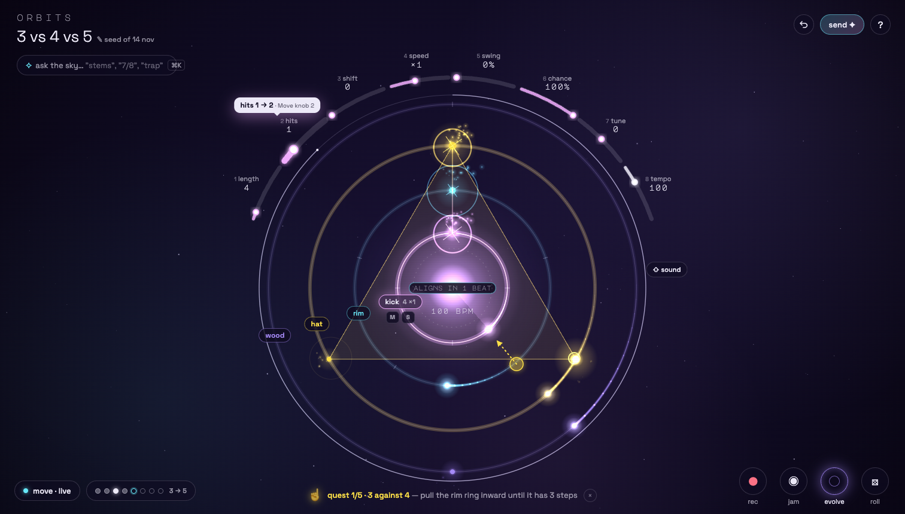
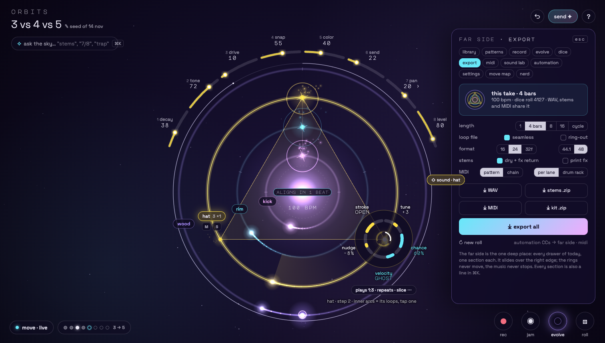

# The sky is the instrument





(`mock.html` = main screen, `mock.html#deep` = the deep state. The rings, comets and planets in both are frames of the
real canvas, captured in focus mode at 1512×860 while playing, muted. Everything on top of them is the proposal.)

## 1. Concept in one sentence

**Focus mode becomes the app**: the orbit fills the window, and every control lives either *on* the orbit (the
sun is play, rings carry their names, a crown of 8 arc-knobs hugs the system like the Move's 8 encoders, planets open
into petals of their locks) or in **one** deep place (the *far side* sheet, also searchable as *ask the sky*, ⌘K).
Nothing else.

## 2. Who it is for

- **The conductor (IDM / ambient, Move in hand).** The Move already *is* the panel. The screen's job is to show what the
  hands are doing, big and in the music's own geometry, not repeat the Move as 160 buttons. The crown is the
  Move's knob row, 1:1, in the same order, and it lights when a knob is touched.
- **The first-minute visitor (phone or laptop, no Move).** Sees a glowing system and four words: *tap the sun*. Then a
  quest whisper with a ghost hand shows the next gesture. They feel creative in seconds and meet depth only when
  they reach for it.
- **The power user / producer.** Nothing is cut. Every drawer is a section of the far side, unchanged inside, and every
  control is a line in ⌘K ("stems", "7/8", "evolve every 8", "kit 909", "midi clock out"). Faster than opening the
  right drawer today.

## 3. The screen at 1512×860

```
┌──────────────────────────────────────────────────────────────────────────────────────────────────────────┐
│ ORBITS                                                                              [↶]  [send ✦]  [?]   │
│ 3 vs 4 vs 5 ✎ seed of 14 nov          4 speed   5 swing                                                  │
│ [✧ ask the sky…              ⌘K]   3 shift  ╭──── ×1 ──── 0% ────╮  6 chance                             │
│                              2 hits ╭──╯         CROWN          ╰──╮ 100%                                │
│                                  ╭──╯    (the Move's 8 knobs:       ╰──╮ 7 tune                          │
│                        1 length ╱         lane, or ⇧ sound)            ╲                                 │
│                              4 ╱      ╭───────────────────────╮         ╲ 8 tempo 100                    │
│                               │      ╱   ╭───────────────╮     ╲         │                               │
│                               │     │   ╱   ╭───────╮    ╲     │         │   [⇧ sound]                    │
│                               │     │  │   │  SUN  │     │    │         │                               │
│                               │     │  │   │ ▶/■   │     │    │         │                               │
│                               │ wood hat rim kick 4×1 bpm │    │         │                               │
│                               │     │  │   [M][S]  ╱     │    │         │   ← lane tags ride the rings   │
│                                ╲     ╲   ╰───────────────╯   ╱         ╱      (8 o'clock), selected one   │
│                                 ╲      ╰───────────────────╯         ╱        grows mute / solo           │
│                                   ╲      (cycle arc, jam arc, rec halo drawn by the scene as today)       │
│ [● move · live] [● ● ◉ ● ○ ○ ○ ○ 3→5]      ☝ quest 1/5 · 3 against 4 — pull… (×)    (●rec)(◉jam)(◌evo)(⚄roll)
└──────────────────────────────────────────────────────────────────────────────────────────────────────────┘
          deep state: a 360 px "far side" sheet slides in at x ≥ 1128 — the rings (outer crown edge x ≈ 1108) never move
```

- **Rings stay exactly where focus mode puts them today** (centre 756, 481; outer ring r 307; crown r 352). Nothing
  panel-shaped ever covers them, so `layoutHud`/`stageBox` collapse to "the whole window".
- **Four corners, thumb-sized, glassy, monochrome.** Colour on screen means *a lane*; the chrome is star-white at low
  alpha. Space Grotesk for words, Major Mono only for numbers on the sky.
- **The screen breathes.** While playing and the pointer/Move hands are idle for 3 s, the corners fade to 35 % and the
  crown to its arcs only (labels fade); any pointer move, key or Move touch brings them back in 120 ms. Reduced motion:
  no fade, a fixed 70 %.
- A full-screen browser (1512×982) just gets more sky: the system is still centred, corners stick to the corners.

**Visible controls on the main screen: 29** (title, ask, undo, send, help · 8 crown arcs + ⇧ sound · 4 lane tags +
mute + solo · the sun · Move pill · slots pill · 4 orbs · quest ×). Today: **160**, plus 13 drawers. 6 lanes = 31.
The planets and ticks are the instrument itself and are not counted, as they aren't today.

## 4. Interaction model

### On the canvas (mouse, pen, touch alike)

| Gesture | Where | Does |
|---|---|---|
| tap | **the sun** | play / stop (it shows ▶ when stopped, pulses "tap the sun" on first visit) |
| press and hold | the sun, while playing | **fill** while held (the sun flares); release = back. A tap < 250 ms never fills |
| Shift+click / double-tap | the sun | fill next bar (latch); again before the bar = cancel |
| tap | a ring (between ticks) | select the lane (crown, tag and petals follow) |
| tap / drag / pull / pinch / long-press | ticks and planets | exactly as today (I1): add a hit, on → accent → ghost → off, rotate, length, length, **petal** |
| long-press / right-click | a planet | **planet petal**: its locks as arc sliders round the planet (tune, chance, velocity, nudge, stroke / slice), the a:b condition arcs (tap one = play on that loop), "plays · repeats · slice ⋯" opens the rest (spacing curve, pitch ramp, fade, trim, direction) in the far side's lock section |
| long-press / right-click | a lane tag or empty ring | **lane petal**: voice ◀ ▶, kit, mute, solo, choke, sample (file / mic / break), clear lane, euclid mode, scale, modulate, timbre dice |
| press and drag | **the empty sky** | performance pad: left = low-pass, right = high-pass, a detent at "off" (the Move wheel). Drag up while held = delay throw (the + button); release = echoes ring out. A small "filter ✕" chip appears at the bottom while a filter is on |
| right-click | the empty sky | *ask the sky* opens at the pointer |
| drop a file | a ring | sample on that lane (as today) |
| drag / scroll / arrows | a crown arc | the knob (Shift = fine, double-click = start value). Crown 1–8 = Move knobs 1–8: length · hits · shift · speed · swing · chance · tune · tempo; with ⇧ (chip, Shift key, Move Shift): decay · tone · drive · snap · color · send · pan · level |

### Corners

- **Title** = the beat's name. Tap = rename = save to the library (the library is the far side's first section, a
  gallery of ring thumbnails, I4). Under it, the seed or lineage ("seed of 14 nov", "remix of …").
- **ask the sky (⌘K, /)**: every control in the app is a command with synonyms. Typing "stem" shows *export stems*
  and *stems: dry + fx return*. Enter runs a one-shot action, or opens its far-side section with the control
  focused. Empty query = recents + *today's seed* + the 7 grooves. This also is the keyboard user's map.
- **↶** undo, hold = redo (and a history scrub on long hold); every destructive act also toasts "undo".
- **send ✦** = copy the link (I2); long-press / ⋯ = radial: link · 4 bars of audio · postcard (video).
- **?** = the help overlay as today, plus "show me" buttons that replay each ghost-hand gesture.
- **Move pill** (only where Web MIDI exists): dot = connected; tap = connect; long-press = live mode on/off, disconnect,
  "move map" (the full Move table, far side).
- **Slots pill**: 8 moons (filled = saved, white = playing, cyan ring = queued). Tap = radial of 8 slots round the
  pill; tap a slot = load, long-press = save / chain / erase (as today's slot menu). Hold Loop on the Move = the radial
  opens by itself and shows what each step button will load.
- **Mode orbs**: ● **rec** (arm live record), ◉ **jam**, ◌ **evolve**, ⚄ **roll** (musical randomize; long-press =
  wild; swipe up = the groove carousel: today's seed + 7 grooves). Long-press rec / jam / evolve = that section of the
  far side (quantize, knob recording, evolve weights, coupling…). Their *state* is drawn on the sky as today (red
  breathing halo, jam arc, evolve = a slow dust ring, dice locked = a die glyph on the sun).

### Keyboard

Everything that works today keeps working (Space, F, ?, pad rows, hold 0, Alt+1–6, ⌘Z). New: ⌘K or / = ask; [ ] =
previous / next lane; Shift = flip the crown (as the Move's Shift); Esc closes petal → far side → ask, in that order.
Tab order: title → ask → **sun** → crown 1–8 → ⇧ → lane tags → **the rings** (one tab stop: a roving grid, ←/→ along
the ring = steps, ↑/↓ = rings, Enter = tap, Shift+Enter = accent, Shift+F10 / menu key = petal) → corners. Every crown
arc and petal arc is a `role="slider"` with the gauge's current names (T3), so the screen reader story gets *better*:
no hidden drawer to find first.

### Ableton Move (unchanged mapping, new echo on screen)

The Move's table stays word for word (far side · move map). What changes is that the screen answers it:

- **touch a knob** → its crown arc swells, glows and shows a white bubble ("hits 1 → 2 · Move knob 2"); with record
  armed the arc draws its automation trail.
- **Shift held** → the crown flips to sound, in the lane's colour (deep mock).
- **Track 1–4** → the ring and its tag light; the crown recolours.
- **hold a step** → that planet's petal opens on screen, each arc labelled with the Move control that sets it (knob 1
  tune, 2 chance, 3 velocity, jog wheel nudge, push jog stroke, knob 8 condition; 4–7 under "⋯"). The Move's
  "hold step + knob" stops being invisible.
- **hold Loop / Duplicate** → the slots radial opens. **Wheel** → the sky shows the filter sweep as a tint at the edges.
- **live mode off** → the Move pill says "move · edit".

## 5. Where every current feature goes

"Ask" = also a command in ⌘K (every row is; noted only where it is the *main* way).

| Feature | Today | In this proposal |
|---|---|---|
| Play / stop | big button, top bar; Space; Move Play | **tap the sun**; Space; Move Play |
| Tempo | gauge in the transport strip; Move knob 8 | crown arc 8 (lane mode); bpm shown under the sun; Move knob 8 |
| Tap tempo | `tap` button; Move Shift+Record | long-press crown arc 8 = tap on the sun to the beat; Move Shift+Record |
| Undo / redo | two buttons; ⌘Z; Move Undo | one ↶ (hold = redo, history scrub); ⌘Z; Move Undo; "undo" toast |
| Fill (hold) | button; hold 0; hold Layout | **hold the sun**; hold 0; hold Layout |
| Fill next bar (latch) | button; Shift+Layout | Shift+click / double-tap the sun; Shift+Layout |
| Performance filter | `fx` gauge in the strip; wheel | **drag the empty sky** left/right (detent at off); wheel; "filter ✕" chip while on |
| Delay throw | `throw (hold)` button; hold + | sky drag upward while held; hold + |
| Humanize | gauge in Humanize drawer; Shift+wheel | far side · groove; Shift+wheel; ask "humanize" |
| Jam (record lane tracks) + progress, download, discard | `● jam` + jam panel | ◉ jam orb; progress is the scene's jam arc (as today); when done the orb grows "⤓ tracks · discard" |
| Share link | `share` | **send ✦** |
| Share 4 bars of audio, postcard (video) | `…` menu | send ✦ long-press radial |
| Help (keys & mouse) | `?` dialog | `?` (same dialog + "show me" ghost-hand replays) |
| Move: connect, status, live mode | pill + Connect button + chip | one Move pill (tap / long-press) |
| Status readout (bpm, playing, slot, rec, evolve, kit, fill, filter, throw, mutes, jam) | 3-line text under the header | **drawn**: sun (play, bpm, fill flare, dice glyph), slots pill, orbs (rec/evolve/jam lit), filter chip, tags (mute, pending mute ⇥), crown 8; full text in far side · nerd |
| Lane legend (voice, length × speed) | row above the rings | **lane tags on the rings** (selected one shows `4 ×1`) |
| Alignment countdown, cycle arc, ghost flashes, condition arcs, rec halo, jam arc, bloom | canvas | canvas, unchanged |
| Welcome back (keep jamming / start fresh) | banner | the title reads "welcome back · your beat"; sun pulses; "start fresh" = roll orb's carousel first card |
| Gift dialog (hear, remix, back to my beat) | dialog | unchanged (it already is the delight moment) |
| Quests (card, skip, hide) | card in the right column | **quest whisper** at the bottom + a ghost hand drawn on the sky doing the gesture; × hides, long-press = skip |
| Simple / everything view | segmented switch | gone as a switch: the main screen *is* simple; the far side *is* everything. Quests on = plain words (I7), off = full names (setting in far side · settings) |
| Init | button | ask "init" / roll orb carousel "empty" |
| Save / load setup, library list | 2 buttons + Library drawer | title tap = save; far side · library (gallery, I4); ask "load …" |
| Randomize / wild | 2 buttons | ⚄ roll orb (tap / long-press); Move Capture |
| Clear lane | button | lane petal; Move Delete |
| Starter grooves + today's seed | 8 chips | roll orb swipe-up carousel; ask "trap"; empty ⌘K shows them |
| Lane select | 4–6 lane tabs; touch a ring; Alt+1–6 | lane tags / touch a ring; Alt+1–6, [ ]; Move Track |
| Length, hits, shift, speed, swing, chance, tune | 9 gauges in the lane drawer | crown arcs 1–7 (Move knobs 1–7) + ring gestures |
| Push / pull, vel humanize | gauges in the lane drawer | lane petal "groove" arcs; far side · groove |
| Swing template | 6-way segmented | long-press crown arc 5 (swing) = a radial of the 6 templates |
| Step strip (32 steps, pages, playhead) | button row in the lane drawer | **the ring's ticks** (+ roving keyboard grid); Move steps; far side · automation shows a linear strip for long lanes |
| Step tap cycle / accent / ghost | step buttons | tap a tick/planet (as today), Shift = accent |
| Step locks (tune, chance, vel, decay, tone, snap, color, nudge) | lock panel in the drawer; ring radial pills | **planet petal** arcs (first five), "⋯" for decay · tone · snap · color; Move hold step + knobs |
| Condition (every / on loop / only), repeats, fade, spacing curve, pitch ramp | lock panel trig row | petal: the a:b arcs round the planet (tap = toggle a loop), "plays · repeats ⋯" → far side · lock section |
| Stroke (articulation), slice per step, per-step trim, direction | lock panel | petal arc 5 (stroke or slice, whichever the lane has); trim / direction in "⋯" |
| Automation strip (picker, ½, ×2, clear, clear lane) | under the steps | crown arcs show an "A" dot and move on playback; tap the dot = far side · automation (curve, playhead, ½, ×2, clear); Move touch + Delete |
| Voice, kit | 2 selects | lane petal (voice ◀ ▶, kit); Move ◀ ▶, Shift+◀ ▶; ask "kit 909" |
| Mute, solo, mute on next bar | buttons + chip | tag M / S on the selected lane; Move Mute; "on next bar" in the lane petal |
| Chokes | segmented | lane petal |
| Sample: load file, mic, break file + slices, Unassembler slices, trim, reverse | sample row + grids | lane petal "sample" → far side · sound lab; drop a file on a ring |
| Sound knobs (decay, tone, drive, snap, color, send, pan, level) | 8 gauges | **crown with ⇧** (chip, Shift, Move Shift) |
| Generative: euclid mode, modulate, timbre dice, scale | Generative block | lane petal → far side · sound lab |
| Meter (time signature), lane count (4 / 6) | Patterns drawer | far side · patterns; ask "7/8", "6 lanes" |
| Slots: load, save, chain, erase, chain info, switch timing, restart, bars per slot, stop chain | Patterns drawer | **slots pill** + radial (load / save / chain / erase); timing, restart, bars, stop chain in far side · patterns; Move Loop / Duplicate |
| Record: arm, knob recording off/touch/latch, accent above, quantize, pitch | Record drawer | ● rec orb (tap = arm, long-press = far side · record); Move Record |
| Evolve: on, home = now, touches, every/amount/home after/gravity/max cycle, weights, lanes, coupling mode + gauges + matrix | Evolve drawer | ◌ evolve orb (tap = on); long-press = far side · evolve (all of it, the matrix drawn as lines between ring tags); Move − |
| Dice: free/locked, seed, re-roll, pattern from seed, repeat | Dice drawer | far side · dice; the die glyph on the sun when locked (tap it = re-roll) |
| Export: link, length, loop, format, ring-out, dry, print fx, MIDI of / tracks, WAV, stems, MIDI, kit, all, new roll, status | Export drawer | far side · export (deep mock), ask "stems" / "export all" |
| MIDI: enable, out, clock out, per-lane note/channel/gate/offset, latency, in, follow, CC per parameter | MIDI drawer (advanced) | far side · midi |
| Engine A/B, reset phase, focus mode | Settings drawer | far side · settings; focus mode becomes **zen** (F: even the corners and crown go, only the sky) |
| Nerd stats | drawer | far side · nerd |
| Move controls table | bottom-left popover | far side · move map; Move pill long-press |
| Stress meter | `?debug` | `?debug`, unchanged |
| Keyboard pads (z–, a–k, q–i, 1–8) | keys | unchanged; the ring under the keys' row glows while a key is held |

## 6. What disappears from view

Both side columns · the transport strip (tap, undo, redo, fill, latch, fx gauge, throw, jam) · the three-line
readout · the ring legend row · Connect Move as a big button and the live-mode chip · the quest *card* · the hud row
(init, save, load, randomize, wild, clear lane) · 8 groove chips · lane tabs · the whole lane drawer (9 gauges, swing
template, 32 step buttons, automation strip, lock panel, voice/kit selects, mute/solo/chokes, sample row, slice grid,
8 sound gauges, generative block) · 13 drawers · the simple/everything switch · help paragraphs on screen.

All of it is one tap or one word away (table above), and most of it is under your hands on the Move.

## 7. Cost (rough)

| Phase | What | Size |
|---|---|---|
| RD-1 Shell | Focus-mode layout as the default; corners; `layoutHud` → full-window stage; the *far side* sheet that **re-hosts today's drawer DOM as-is** (each `<details>` body becomes a section; no logic rewritten) | M |
| RD-2 Crown | an arc variant of `gauge.js` (same API: role slider, Shift fine, double-click reset, onStart/onEnd for A3 recording); lane ↔ sound flip on Shift; Move knob-touch echo and bubble | M |
| RD-3 Sun + sky pad | sun hit-test (play / hold fill / latch), sky drag → `setFilter` / `setThrow`, filter chip | S |
| RD-4 Petals | planet petal (arcs replace today's ring-menu pills; reuse `LOCK_UI`, `lockValue`, `editLocks`), tappable condition arcs, lane petal; Move hold-step opens the petal | M |
| RD-5 Ask the sky | command registry (each control registers name, synonyms, run / reveal), fuzzy search, recents, keyboard map | M |
| RD-6 Juice + learning | lane tags, slots radial, orbs, quest whisper with ghost-hand paths drawn by `scene.js`, breathing fade, "show me" in help | S |
| RD-7 Access + phone | roving canvas grid, focus order, reduced motion; phone: crown as a half-ring *under* the system (thumb zone), far side and ask as full-height bottom sheets | M |

About **L overall** (≈ 7 playbooks). RD-1 alone already ships the calmer screen; RD-2 is where the Move story lands.

## 8. Risks

1. **Discoverability.** Hidden gestures (hold the sun, drag the sky, long-press a planet) are invisible until someone
   shows you. Mitigation: quests teach exactly these five gestures with ghost hands; ⌘K finds everything by name;
   right-click always opens something; "show me" in help. Still the biggest risk.
2. **Accidental actions on a live set.** A hold on the sun that becomes a tap stops the music; a sky drag that was
   meant as a click filters the mix. Mitigation: 250 ms tap/hold threshold, 12 px drag slop, the filter detent, and the
   Move remains the safe surface (live mode).
3. **Accessibility of a canvas UI.** Arc sliders and a roving ring grid must be real DOM with real names, not canvas
   pixels. Done well it's better than today; done badly it's a regression on ORBIT2-03.
4. **Precision on the crown.** A 98 px arc for 1–32 steps is 3 px per step. Mitigation: vertical drag (like the gauges)
   works on arcs too, and a fine Shift; the rings themselves are the precise length control.
5. **Power-user muscle memory.** Everything moves. The far side keeps each drawer's insides identical so the move is
   "one level", not a relearn.
6. **Overlay vs canvas gestures.** DOM petals and tags sit over a canvas that owns pointer events; hit-testing has to
   agree (`scene.locate` must ignore points under overlay elements).

## 9. What I'd test first

1. **The 5-second test + first minute** (5 newcomers, phone and laptop, no instructions): do they tap the sun? Do they
   make "3 against 4" with only the quest whisper? Today's baseline: time to first sound and to first edit.
2. **The conductor with the Move, 20 minutes of playing**: how often do eyes go to the screen, and does the crown echo
   answer what they were looking for? Compare against today's panels.
3. **Five power tasks timed against today**: export stems, set a 1:3 condition, switch to 7/8, load a break and slice
   it, chain slots 1→3. Pass = no slower than today with ⌘K, faster for at least three.
4. **Prototype order**: a `?rd=rio` flag in the lab page that hides both columns (focus mode without the exit button),
   adds the crown and the sun-as-play. Two days of work, and enough to run tests 1 and 2.
