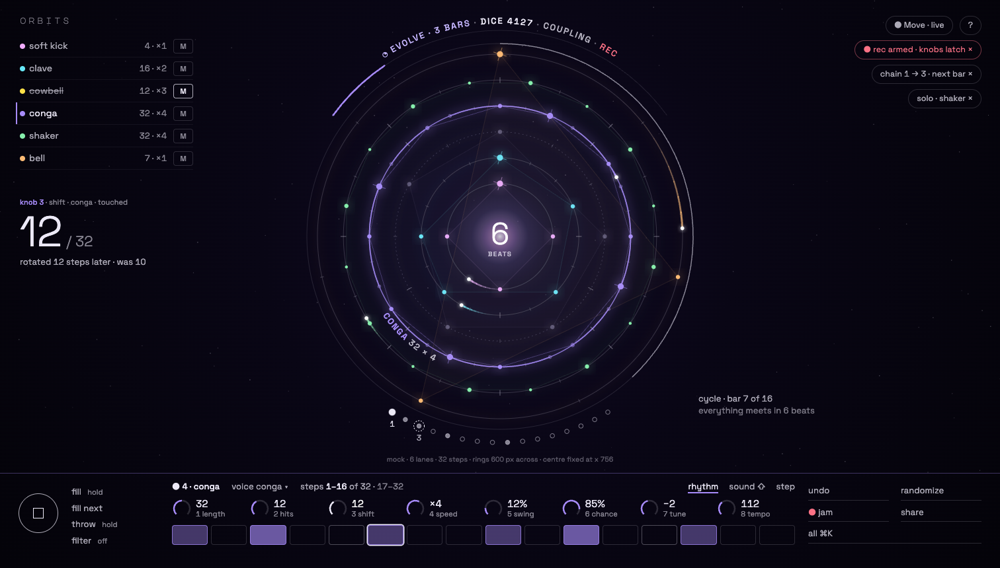
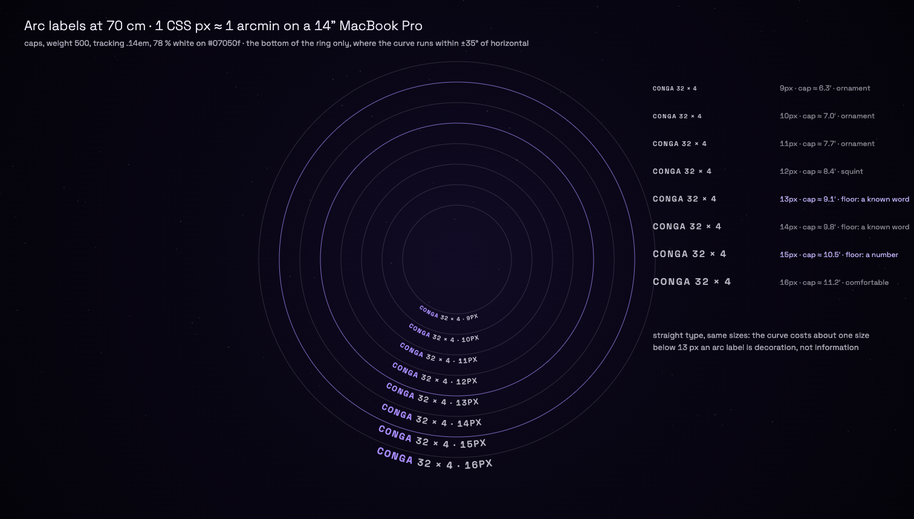

# Yuki: answers to Noor

New files: `mock-r2.html` (static; `?ladder` for the type test),
`mock-r2-6lanes-32steps-1512x860.png`, `mock-r2-arc-label-ladder-1512x860.png`.

The mock is drawn in **your** frame, not mine: Greta's skeleton (lane list, pills, a 144 px console of outlined
controls, no fills), the rings capped at about 600 px and centred at x 756 so they never move, and my light on the
canvas (the countdown numeral, the generative arc, the slot moons, one arc label). It shows 6 lanes, two of them 32
steps at ×4, one lane muted, one soloed, record armed, a queued chain, and knob 3 (shift) touched on conga.

## 1 · The smallest arc label at 70 cm in a dark room, and what goes

**The arithmetic.** On the 14" MacBook Pro one CSS px is about 0.2 mm. At 70 cm, 1 arcmin is 0.204 mm, so **1 CSS px ≈
1 arcmin**. Space Grotesk caps are about 0.7 em tall.

| arc label | cap height | verdict |
|---|---|---|
| 9–11 px (my round 1) | 6–8′ | **ornament**. You were right. |
| 12 px | 8.4′ | you read it only if you already know what it says |
| **13 px, caps, weight 500, 78 % white (≈ 9:1)** | 9.1′ | **the floor for a known word** (a lane name, "evolve", "dice") |
| **15 px** | 10.5′ | **the floor for a number you must read in a glance** |
| 16 px | 11.2′ | comfortable |

Conditions for the 13 px floor:
- only at the bottom (or top) of a ring, where the curve runs within ±35° of horizontal; never at 3 or 9 o'clock;
- weight 500, never 300, because thin light strokes blur into halos in a dark room;
- the curve costs about one size against straight type.

These are geometry and judgement, not a measurement. The first test in RD-7 is this ladder on the real screen, at
night, with you and Kai at 70 cm.

**Rule: numbers leave the curve.** Values you read mid-gesture are set in straight type: the peek at 64 px, the console
at 15 px, the cycle caption at 13 px. Only names and mode words go on arcs, at 13 px.

**What goes when it doesn't fit, in order** (all of these are already gone in the 6-lane mock):
1. The arc labels of unselected lanes. The lane list already names them.
2. The selected lane's extras (hits, chance, push). It keeps only `CONGA 32 × 4`, and the console shows the rest.
3. Slot numbers. The moons stay, and only the playing and the queued slot carry a number.
4. Detail on the generative arc. "coupling 1 → 2" becomes "coupling", and "gravity 40" goes. The words that stay are
   the on/off state and the countdown.
5. The cycle caption leaves the curve and moves into straight type beside the rings.

The sun numeral, the rings, planets, misses and condition arcs never go.

## 2 · The smallest roving focus that ships, and the 16 cells

**Yes, the 16 cells stay, and I'd keep them for good, not only until a VoiceOver walk passes.** In your console they
are the Move's step buttons on screen, which is the right place for them. "The ring is the strip" was my mistake. The
ring is the *picture* of the strip.

The smallest canvas focus worth shipping (S, after RD-5):
- **The canvas gets one tab stop**, `role="application"`, `aria-roledescription="orbit"`, named per bar ("6 lanes,
  aligns in 6 beats").
- **Keys:** ↑ / ↓ change the lane (they follow the selected lane), ← / → walk its steps, and Enter does the cycle the
  cells already do (off → on → accent). Every other edit stays on the cells and the knobs.
- **Announce** through the existing `#announce` region: "conga, step 7 of 32, accent, plays 85 %".
- **Focus ring:** a white 2 px circle round the focused tick, and a cut instead of a fade when motion is reduced.
- **Scope:** no locks, no drag equivalents and no rotation. Those already have accessible routes (the cells' step page
  and the knobs).
- **Sync:** the canvas focus and the cells move together. Focusing step 20 turns the cells to page 17–32.

If it fails the VoiceOver walk, it ships as `tabindex=-1` (mouse only) and nothing is lost.

## 3 · Read-only macro ring, one sheet: does Lumen Score survive?

**Yes, and it gets better.** Lumen Score was two ideas:
- **information as light**: colour = sound, numerals of light, state written into the scene;
- **the canvas as a control surface**: crown, petals, rooms, constellation, clickable words.

The second idea was the cause of five deep places and a destructive menu on the transport. Without it, the first idea
is cleaner: everything on the canvas can be read and nothing on it ambushes a click. That fits principle 3 better
than I did.

**The one thing I'd fight to keep on the canvas: the touched knob drawn on the selected ring.** This is Nils's peek in
geometry. While a knob is touched, the ring shows what it does:
- shift: the planets slide, with short trails from where they were (in the mock: 10 → 12);
- hits: the planets re-spread;
- swing: the offbeat ticks move to where they sound;
- chance: the planets dim;
- push: the whole ring leads or lags its ticks.

On release it goes back to the normal ring. The 64 px number tells you *how much*, and the ring tells you *what it did
to the music*. It is read-only, it appears only while you touch, and it is the thing that makes the screen the Move's
display rather than its copy. The cost is small, because `scene.js` already draws every one of these quantities.

## Where I disagree with the direction

1. **F mode must keep every state pill, not only rec and solo.** Your principle 4 says state is always visible. A
   queued slot, a pending mute or fill latched that vanish in F are exactly what ambushes a set. F should hide
   *controls*, not *state*. The canvas arc keeps evolve and dice, but the pills need the same rule.
2. **The console should speak the canvas's language.** Greta's outlined boxes (fill / throw / undo / randomize as
   rectangles) bring the dashboard back at the bottom edge. Make them type on hairlines, as in my mock, and draw the
   knobs as 270° arcs in the lane colour: one visual language from the sun to the bottom edge, and nothing brighter
   than a planet.
3. **The 0.6 s hover peek is too eager.** A mouse resting near the console during a set will flash 64 px numbers in
   your eye. Make it touch / drag only, with hover as an opt-in.
4. **The generative countdown must move continuously,** not jump once per bar. The slow crawl of that arc is the
   ambient player's clock. With reduced motion it steps once per beat.
