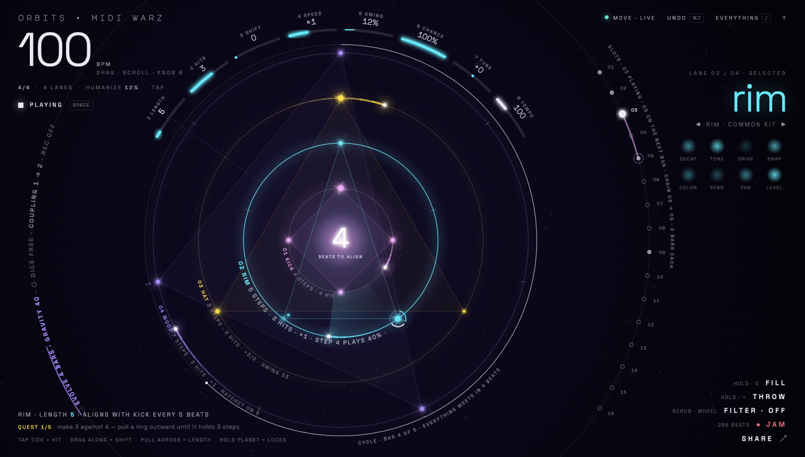
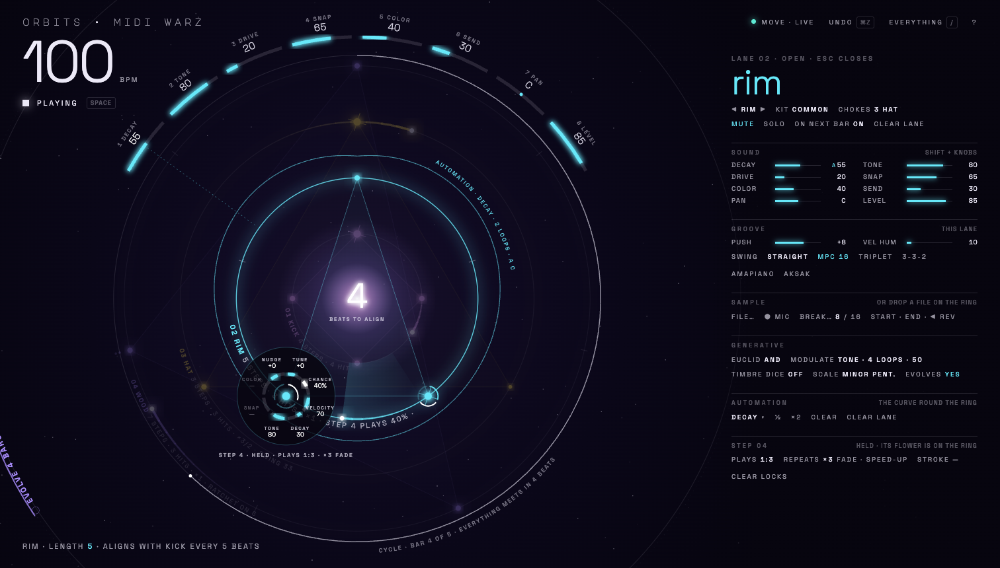

# Lumen Score



## 1 · The concept in one sentence

**The orbit is the score: it fills the screen, every number is written as type or light on the ring it changes, and the
only chrome is a hairline of words in the four corners.**

The rule behind it: **colour is sound** (lane colours, nothing else is coloured), **white is structure** (type, ticks,
the cycle, the slots), **red is recording**. Chrome never moves; only light moves.

## 2 · Who it is for

- **The conductor at 1512×860.** An IDM / ambient musician with a Move on the desk. The eyes go to the screen for
  *what is happening* (alignment, cycle, which slot comes next, what a knob just did), the hands stay on the Move. Today
  the screen repeats the Move as 160 controls. Here the screen shows what the Move is doing and sends the rest to one
  place you call up.
- **The visitor without a Move.** Everything still works with mouse and keyboard: you play the orbit by touching it
  (I1 already makes this possible), and every hidden feature is a word away in the "everything" palette (`/`).
- **The audience** (stream, gallery, festival projection): the main screen *is* the visual. No "focus mode" needed for a
  set. F hides even the hairline layer.

## 3 · The screen at 1512×860

Mock: `mock.html` (main) and `mock.html?edit` (the deep state of a lane), screenshots `mock-1512x860.png` and
`mock-edit-1512x860.png`.

```
┌──────────────────────────────────────────────────────────────────────────────────────────────────────────┐
│ ORBITS · MIDI WARZ          3 shift  4 speed  5 swing  6 chance               ● MOVE · LIVE  UNDO  /  ?  │
│ 100 BPM         2 hits ╭──────────── THE CROWN (knobs 1–8) ───────────╮ 7 tune                          │
│ 4/4 · 4 LANES · HUMANIZE 12% · TAP  1 length                          8 tempo   S  ·   LANE 02 / 04      │
│ ■ PLAYING  [space]      ╭───────────── cycle arc ─────────────╮              L  ◉03         rim          │
│   R                    ╱    ╭─────── 04 wood ────────╮          ╲            O   04     ◀ rim · common ▶ │
│   E                   │    ╱  ╭──── 03 hat ─────╮     ╲          │           T   ◌05     ◍ ◍ ◍ ◍ (sound  │
│ M C                   │   │  ╱ ╭─ 02 rim ──╮     ╲     │         │           S   06      ◍ ◍ ◍ ◍  as light)│
│ O O                   │   │ │ │ ╭ kick ╮   │      │    │         │               ...                     │
│ D U   (macro ring,    │   │ │ │ │  4   │   │      │    │         │  (macro ring, right arc:              │
│ E P    left arc:      │   │ │ │ ╰──────╯   │      │    │         │   16 slots, chain, queued slot)       │
│ S L    evolve, dice,  │   │  ╲ 02 RIM 5 STEPS · 3 HITS ╱  │      │                                       │
│   E    coupling, rec) │    ╲  03 HAT 3 STEPS ×3/2 ╱    ╱       │                       HOLD·0    FILL  │
│   ...                  ╲    ╰ 04 WOOD 7 STEPS ─╯      ╱                               HOLD·+   THROW  │
│ RIM · LENGTH 5 · ALIGNS WITH KICK EVERY 5 BEATS  (ticker)    CYCLE · BAR 4 OF 5     SCRUB  FILTER·OFF  │
│ QUEST 1/5 make 3 against 4 — pull a ring outward …                                       ● JAM        │
│ TAP TICK = HIT · DRAG ALONG = SHIFT · PULL ACROSS = LENGTH · HOLD PLANET = LOCKS            SHARE ↗    │
└──────────────────────────────────────────────────────────────────────────────────────────────────────────┘
```

Layers, from the centre out:

1. **The sun** (core): the alignment countdown as a numeral of light ("4 · beats to align"); stopped, it is a big ▶.
2. **Lane rings** (as today: ticks, planets, polygons, comets, misses, condition arcs, ratchet echoes, lock moons). New:
   **each ring carries its own name and numbers as type**, set along the ring in the lower-left quadrant
   (`02 RIM  5 STEPS · 3 HITS · ×1 · STEP 4 PLAYS 40% · PUSH +8 MS`). The selected ring is in full colour and its label
   is brighter; the others are hairlines. This replaces the fixed legend (C5), the lane tabs and the "nerd stats" lane
   rows.
3. **The cycle arc** (V6, kept), now captioned in words along the bottom-right ("cycle · bar 4 of 5 · everything meets
   in 4 beats").
4. **The crown**: eight arcs over the top, read left to right like the Move's knob row: `1 length · 2 hits · 3 shift ·
   4 speed · 5 swing · 6 chance · 7 tune · 8 tempo`. The fill of each arc is the value, the number is set above it.
   **Hold Shift (screen or Move) and the crown becomes the sound** (decay · tone · drive · snap · color · send · pan ·
   level), in the same places as on the hardware. Hold a step and it becomes the step's locks. The crown is the
   Move made visible: you learn the hardware by looking at the screen.
5. **The macro ring** (r ≈ 580 px): bigger than the screen, it bleeds off the top and bottom edges, so the orbit is
   edge to edge. Its **right arc holds the 16 slots** (the playing one bright, the queued one dashed, the chain as a
   lit magenta arc). Its **left arc holds the generative modes as words that light up** (`◌ evolve 4 bars · gravity 40
   · ○ dice free · coupling 1 → 2 · rec off`), with a short arc counting down to the next mutation.
6. **The hairline layer** (four corners, nothing in between):
   - top-left: wordmark, **tempo as a 88 px light numeral** (drag, scroll, knob 8), the global line (`4/4 · 4 lanes ·
     humanize 12% · tap`), play state + its key.
   - top-right: `● MOVE · LIVE` (connect, live mode), `UNDO ⌘Z`, `EVERYTHING /`, `?`.
   - right: **the selected lane set as display type** ("rim", 76 px light, lane colour), voice ◀ ▶, kit, and its eight
     sound values as eight soft lights (brightness = value). Click the name: the lane opens (edit state).
   - bottom-left: a one-line ticker (what just changed, in words: this is where toasts and the readout go), the quest as
     one line, the four canvas gestures as a hint (fades after the first week, like the quests).
   - bottom-right: the performance verbs `FILL · THROW · FILTER · ● JAM · SHARE ↗`.

**Typography.** One working face: **Space Grotesk** (already loaded). Weight 300 at display sizes (tempo, lane name,
countdown) so numerals read as light; 500 caps, tracked +0.22 em, 9–11 px for labels; tabular numbers everywhere so
values don't jitter. **Major Mono Display stays only in the wordmark**: it is the identity, and it was the least
legible UI face (backlog: "Readout font", "Status line emphasis").

**Colour.** Background goes from purple-black to a deeper void (#07050f → #140d2a at the sun) so the lane colours
carry more. The nebulae stay, fainter. No filled buttons anywhere; the only filled shapes are planets and lights.

**Full screen (1512×982):** the macro ring grows with the height; the corners stay where they are (they anchor to
the viewport, not the orbit). **Phone:** the rings fill the width, the crown becomes a bottom arc in the thumb zone
(8 arcs, 44 px tall touch bands), corners collapse into a top line (tempo · play) and a bottom line (verbs); the sheet
becomes a bottom sheet. I1 touch gestures and ORBIT2-03 targets are unchanged.

## 4 · The edit state ("open a lane")



Click a ring's name, the big lane name, or press a Move Track button twice: the orbit slides left (≈100 px), the other
rings dim to 28 %, and a **typeset sheet** opens on the right (440 px, no boxes, hairline rules): voice / kit / chokes,
mute · solo · on next bar · clear lane, the 8 sound values as hairline bars (an `A` marks an automated one), groove
(push, vel humanize, swing template), sample (file, mic, break, start/end/reverse), generative (euclid mask, modulate,
timbre dice, scale, evolves this lane), automation (picker, ½, ×2, clear, clear lane), and the held step's condition /
repeats / stroke. `Esc` closes it.

Two things move **onto the orbit** in this state:

- **Automation is drawn as the ring's breath**: the selected parameter's curve is a line around the ring, radius =
  value, with the comet running along it. It replaces the separate curve strip (A4).
- **The lock flower**: hold (or right-click) a planet and eight petals open round it, one per knob (tune · chance ·
  velocity · decay · tone · snap · color · nudge, the Move's hold-step layout); a petal's light is its locked value,
  an empty petal is unlocked. Its condition sits as arcs on the planet (V6), repeats as echoes. Drag a petal round to
  set it; the Move's knobs do the same while the step is held.

## 5 · Interaction model

| Input | What it does |
|---|---|
| **Click a step tick / planet** | as today (I1): add a hit, then on → accent → off |
| **Drag along a ring / across it / pinch** | rotate (shift) / length, as today (I1) |
| **Hold or right-click a planet** | the lock flower (petals = knobs; condition arcs; repeats) |
| **Click a ring's name** | select the lane · again (or Enter) = open the sheet · Alt-click = mute · Shift-click = solo |
| **Drag / scroll a crown arc** | that knob (Shift held: the sound layer). Double-click = default. Arrow keys when focused |
| **Drag / scroll the tempo numeral** | tempo · click `tap` on the beat = tap tempo |
| **Click / hold the sun** | stopped: play · playing: stop. Right-click / long-press: the **constellation menu** (randomize · wild · init · seed of the day · the 7 grooves), a ring of words round the sun |
| **Click a slot mark** | load · Shift = save here · Cmd = add to chain · long-press / right-click = save · chain · erase (today's rules, T1) |
| **Click a mode word** (left arc) | toggle evolve / dice / rec arm; click and hold = its room (see below) |
| **Verbs** | FILL: hold = fill, tap = fill next bar · THROW: hold · FILTER: scrub left = LP, right = HP, double-click = off · JAM: start / stop (the jam arc, as today, round the orbit) · SHARE: the link; hold = audio / postcard |
| **`/`** (or ⌘K, or `EVERYTHING`) | **the palette**: type a verb or a noun ("stems", "kit jungle", "meter 7/8", "6 lanes", "midi out", "gravity 40", "library"). A noun opens its **room** |
| **Rooms** | full-height typographic sheets on the left (the mirror of the lane sheet): Library · Patterns · Record · Evolve · Dice · Export · MIDI · Settings · Move map · Nerd stats. They host today's controls (same gauge.js, re-skinned to hairline bars), one room at a time, Esc closes |
| **Keys** | as today (Space, pad rows, hold 0, Alt+1–6, ⌘Z, ?, Esc) + `/` palette · F = hide the hairline layer too |
| **The Move** | exactly as today (the full table stays the source of truth, now in the "Move map" room). New: the screen *answers* it: a turned knob lights its crown arc and draws a dotted light to the ring it changes; Shift flips the crown; holding a step opens its flower; Track ×2 opens the sheet; Loop held shows slot numbers bright on the macro ring |

## 6 · Where every current feature goes

"Main" = on the main screen; "Sheet" = the lane's edit state; "Flower" = a held planet; "Room X" = a palette room;
"Palette" = a typed command. Every row is also reachable by its Move control where one exists (unchanged).

| Feature (backlog id) | Today | In Lumen Score |
|---|---|---|
| Play / stop | big cyan button, top strip | Main: `■ PLAYING` top-left + the sun + Space; **first tab stop** |
| Tempo | small gauge in the strip | Main: 88 px numeral (drag/scroll); crown arc 8; Move knob 8 |
| Tap tempo | button in the strip | Main: `tap` word in the global line; Move Shift+Record |
| Undo / redo | two buttons in the strip | Main: `UNDO ⌘Z` (Shift-click = redo); keys; Move |
| Fill (hold) | button in the strip | Main: FILL verb (hold); hold 0; Move hold Layout |
| Fill next bar (P3) | button in the strip | Main: FILL verb (tap); Move Shift+Layout |
| Performance filter (P6) | gauge in the strip | Main: FILTER verb (scrub); Move wheel |
| Delay throw (P6) | button in the strip | Main: THROW verb (hold); Move hold + |
| Jam record + progress + download / discard | button + panel | Main: JAM verb; the red arc round the orbit (as today); download / discard as two words in the ticker when the take ends |
| Share link / 4 bars audio / postcard (I2, I3, I5) | button + "…" menu | Main: SHARE (link); hold = audio · postcard words |
| Gift card on opening a link (I2) | dialog | unchanged (already full-screen and typographic) |
| Help (keys & mouse) | `?` dialog | Main: `?` (same dialog, re-set in the new type) |
| Move connect / status / live mode (T6, P1) | pill + 2 buttons, second header row | Main: `● MOVE · LIVE` top-right (2 words) |
| Status readout (C2) | 3-line Major Mono line | gone as a line: tempo, play, slot, rec, evolve, kit are each written where they live (corner, macro ring, lane title); changes appear in the ticker |
| Welcome back / start fresh (F3) | bar on the right | Main: the ticker line ("welcome back · keep jamming · start fresh") |
| First visit demo (F2) | auto | unchanged; the sun pulses ▶ |
| Quests (I6) | card on the right | Main: one line bottom-left (click = skip, × = hide) |
| Simple / everything (I7) | switch, left column | gone: nothing is hidden behind a mode any more; plain words everywhere (hits, shift, speed, chance), the expert words in tooltips and the palette |
| Lane select / tabs (T4) | 4–6 chips | Main: the ring names (a `tablist` in the a11y tree); Alt+1–6; Move Track |
| Lane legend (C5) | row above the rings | Main: on the rings themselves |
| Length / hits / shift / speed (Move knobs 1–4; R2) | 4 gauges in the lane drawer | Main: crown arcs 1–4; ring gestures; the ring label |
| Swing (B1) · chance · tune | gauges | Main: crown arcs 5–7 |
| Swing template (G6) | 6 chips | Sheet: groove line; Palette "swing aksak" |
| Push / pull (G2), vel humanize (G3) | gauges | Sheet: groove rows; the ring label shows a non-zero push |
| Ghost / normal / accent (G4) | tap cycle | unchanged on the ring (ghost = small planet) |
| Steps strip, 32 steps, pages (L1, L5, T2, T5) | 32 buttons under the lane | **gone from view**: the ring is the strip (I1). For keyboard and screen reader the canvas is one `application` with a roving step focus (arrows walk the ring, Enter cycles, Shift+F10/Alt+Enter = flower, "step 4 of 5, accent, 40 %"); pad-row keys unchanged |
| Step locks (G1 nudge, S1 slice, L3 stroke, prob, vel, sound) | lock panel in the drawer | Flower (8 petals); slice and stroke as two choosers in the Sheet's step section |
| Conditions incl. PRE / NEI (R4) | 3 pickers in the lock panel | Flower: arcs round the planet (tap an arc = plays on that loop); Sheet: `plays 1:3` chooser |
| Repeats, fade, spacing, pitch ramp (V4) | lock panel | Flower: drag outward = more echoes; Sheet: fade · spacing · ramp |
| Automation strip, picker, ½, ×2, clear, clear lane (A1–A4) | strip under the steps | Sheet: automation line; the curve drawn round the ring; `A` on the sound row and on the crown arc |
| Knob recording off / touch / latch (A3), accent above, quantize, pitch pads | Record drawer | Main: `rec` word on the macro ring (arm); Room Record for the options |
| Live record arm (B6) | Record drawer | Main: `rec` word; Move Record; the red breathing ring (as today) |
| Voice / kit (L4) | 2 selects in the drawer | Main: ◀ voice ▶ under the lane name; kit in the Sheet and Palette; Move ◀ ▶ / Shift |
| Sound: decay, tone, drive, snap, color, send, pan, level (G5) | 8 gauges | Main: 8 lights (read); crown with Shift (edit); Sheet rows |
| Mute / solo / on next bar (P2, B11) | buttons in the drawer | Main: Alt / Shift-click a ring name (a muted ring is a grey dotted hairline, its label struck); Sheet; Move Mute |
| Chokes | chooser in the drawer | Sheet |
| Sample: file, mic, drop on ring, break 8/16, Unassembler slices, start/end/reverse (S1–S3) | sample row in the drawer | Sheet: sample line; drop a file on a ring (as today); slices grid in the Sheet |
| Euclid mask (V3), modulate (V5), timbre dice, scale | generative block (advanced) | Sheet: generative lines |
| Init / save / load / randomize / wild / clear lane (F4) | 6 buttons | the sun's constellation menu (randomize, wild, init); save / load = Room Library (⌘S, palette); clear lane = Sheet + Move Delete |
| Starter grooves + seed of the day (F1, I5) | 8 chips | the constellation menu round the sun; Palette "groove house" |
| Library gallery with ring thumbnails (I4) | Library drawer | Room Library (the thumbnails become the room: a wall of small orbits) |
| Slots 1–16, load / save / chain / erase (T1) | grid in Patterns drawer | Main: right arc of the macro ring |
| Chain info, switch timing, restart on change (P4), bars per slot, stop chain | Patterns drawer | Main: caption on the slot arc; Room Patterns for the options |
| Meter (R3), lane count (L2) | Patterns drawer | Main: `4/4 · 4 lanes` (click = picker); Palette |
| Global humanize | Humanize drawer | Main: `humanize 12%` (scrub); Move Shift+wheel |
| Evolve on/off, home = now, scope, every, amount, home after, gravity, max cycle, weights, lanes (V1) | Evolve drawer | Main: `◌ evolve` word + countdown arc; Room Evolve for the knobs; "evolves" per lane in the Sheet |
| Coupling mode, lift, matrix (V2) | Evolve drawer | Main: `coupling 1 → 2` word; Room Evolve (the matrix drawn as light beams between ring names) |
| Dice free / locked, seed, re-roll, pattern from seed, repeat | Dice drawer (advanced) | Main: `○ dice` word; Room Dice |
| Export WAV / stems / MIDI / kit / all, formats, dry + FX return, ring-out, MIDI of, tracks, new roll (E1–E6, B5) | Export drawer | Room Export (Palette "stems", "wav 24 48", "export all") |
| MIDI ports, clock out/in, follow, notes/ch per lane, gate, out offset (P5), strokes map, CC per parameter (A7) | MIDI drawer (advanced) | Room MIDI |
| Engine A/B, reset phase, focus mode | Settings drawer | Room Settings; F key |
| Nerd stats | drawer | Room Nerd stats (most of it is now written on the rings anyway) |
| Move controls table | popup bottom-left | Room Move map + the crown teaches it live |
| Stress meter (C4) | `?debug` | unchanged (`?debug`), drawn as a hairline in the bottom edge |
| Alignment countdown (F5), cycle bloom, cycle arc (V6) | pill in the core, arc | the sun's numeral; bloom as today; arc captioned in words |
| Misses, chance as opacity, condition arcs (V6) | canvas | unchanged |
| Bugs B1–B12, clock R1, model / audio | — | untouched (interface only) |

## 7 · What disappears from view

The left column (13 drawers), the right column (quest card, 6 buttons, 8 groove chips, lane tabs, the lane drawer
with ~60 controls), the second header row, the three-line readout, the legend row, the simple / everything switch, the
step-button strip, every filled button. **Visible interactive targets: 54 (today 160)**, ~36 tab stops (slots and
ring names are one group each). Count: corners 11 (home, tempo, tap, meter/lanes, humanize, play, move, live, undo,
`/`, `?`) · crown 8 · ring names 4 · canvas 1 · sun 1 · lane title + voice ◀ ▶ 3 · slots 16 · modes 4 · verbs 5 ·
quest 1.

## 8 · What it costs (rough phases)

| Phase | Scope | Size |
|---|---|---|
| 1 · Stage | canvas full-bleed (drop `stageBox`, one `ringGeo` for the viewport), corners as a CSS grid over it, the new type scale and colour rules; current drawers moved unchanged into one left "room" container opened by `/` | M |
| 2 · Type on the rings | ring labels via `ctx` text on arc (per-glyph rotate, cached per lane state), cycle caption, the sun numeral, the macro ring (slots + modes as hit-testable words), accessible overlay: one focusable button per ring name / slot, positioned on the arc | M |
| 3 · The crown | 8 arc sliders (DOM `role=slider` overlay for a11y, drawn on canvas), Shift layer, Move feedback (light + tether), hold-step layer | M |
| 4 · Lane sheet + flower | the sheet (re-skins existing gauges as hairline rows), lock flower on the canvas with petal drag, automation drawn round the ring | L |
| 5 · Palette + rooms | `/` palette (static command table → existing functions in `app.js`), rooms re-skinned, constellation menu | M |
| 6 · Values as light (optional) | pan shifts a ring's glow left/right, level = line brightness, decay = tail length of a hit's shockwave, send = a faint echo ring | S–M |

No new dependencies; the model, audio, export, Move code stay. Most risk sits in `app.js`'s `layoutHud()` and the
drawer DOM, which phase 1 replaces with a grid (backlog "A CSS grid stage").

## 9 · Risks

- **Legibility of type on a curve.** Arc text at 9–11 px is beautiful and slow to read. Mitigation: labels only in the
  lower-left quadrant where the curve reads left to right, caps + tracking, a minimum 9.5 px, and every value also
  in the crown or the sheet in straight type.
- **Discoverability.** Hiding 100+ controls behind `/`, a held planet and a right-click on the sun can strand the
  visitor who has no Move. Mitigation: the gesture hint line, quests that teach the palette, and the palette lists
  every noun on open (it is also the index).
- **Canvas a11y.** The orbit becomes the main editing surface; screen reader and keyboard parity needs a real roving
  focus model and an announced step state, not just the DOM overlay. This is the biggest engineering risk.
- **Crowding at 6 lanes / 32 steps.** Six labelled rings 0.12 R apart leave ~42 px per lane; labels have to stagger
  further round the ring (or show only the selected lane's numbers).
- **Performance.** Text on arcs every frame is expensive; cache each label as a sprite and redraw only on change.

## 10 · What I'd test first

1. **Five-second test** at 1512×860 with the demo playing: can a new visitor say which lane is selected, its length,
   and when the rings align, without touching anything? (Validates "values written into the visual".)
2. **Crown + Move**: the conductor turns knobs 1–8 without being told the mapping, eyes on screen; do they find
   Shift = sound? Time-to-change-decay vs today.
3. **Palette recall**: "export the stems", "set 7/8", "lock dice" with no other hint: success rate and time.
4. **Ring-label legibility** at 6 lanes / 32 steps and at stage distance (2 m from a 14" screen).
5. **Screen reader walk** of the canvas (VoiceOver): add a hit on lane 3 step 2, accent it, set its condition.
